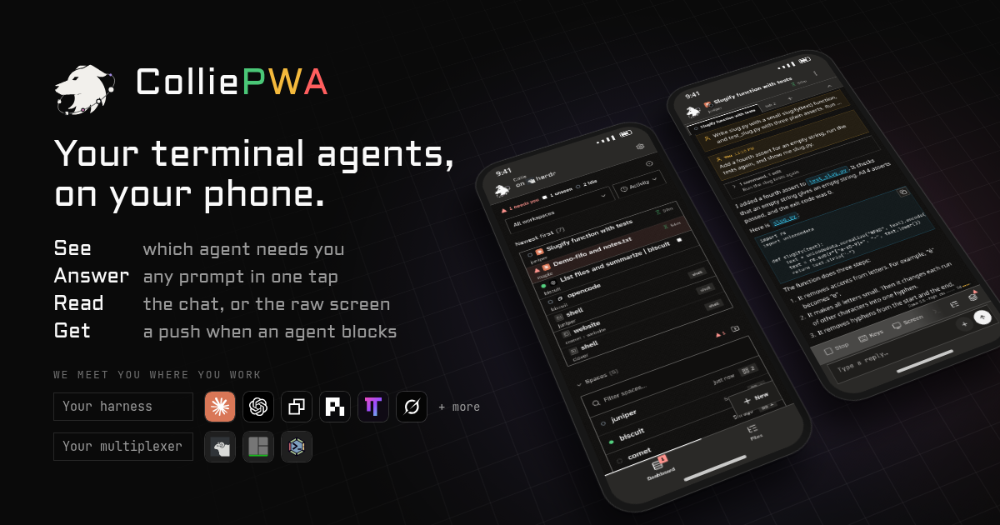
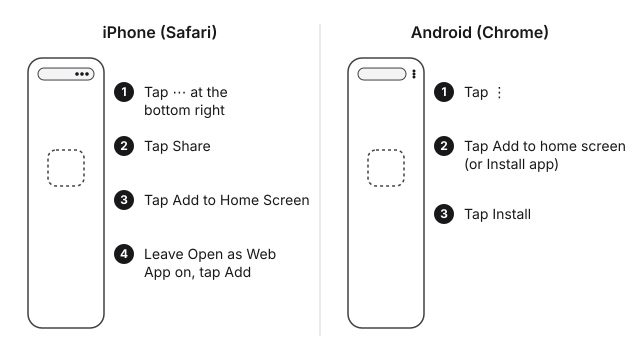
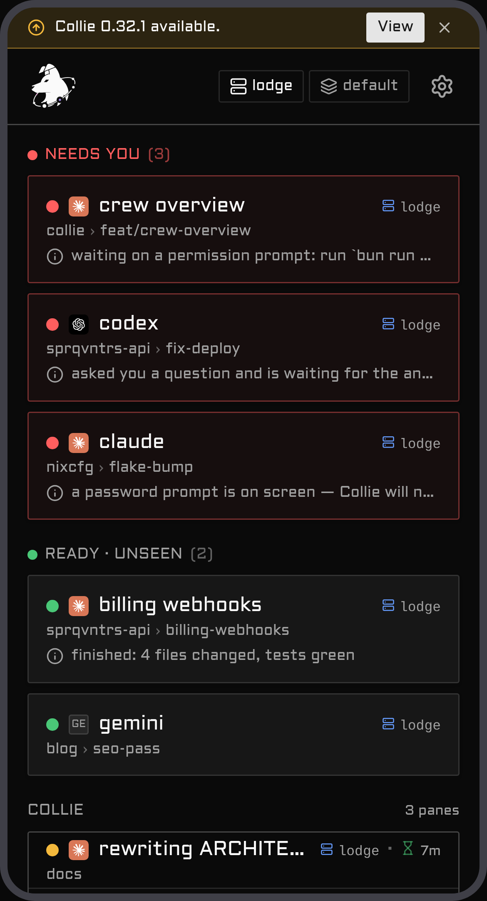
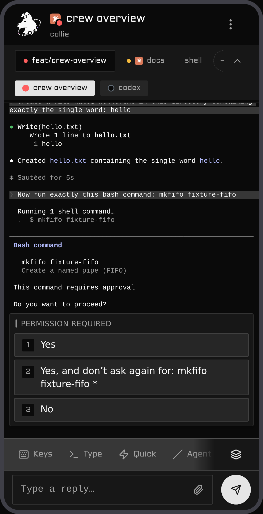
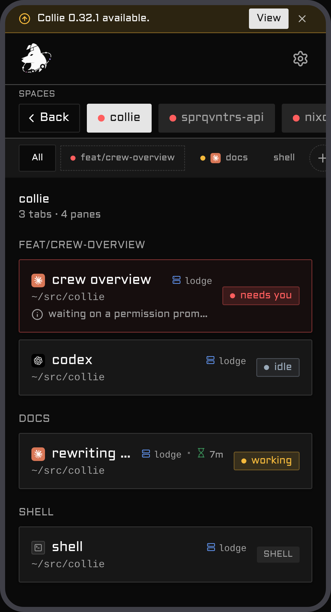
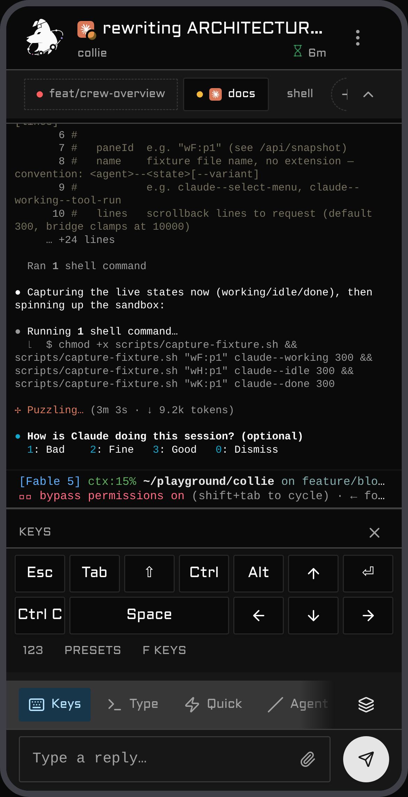
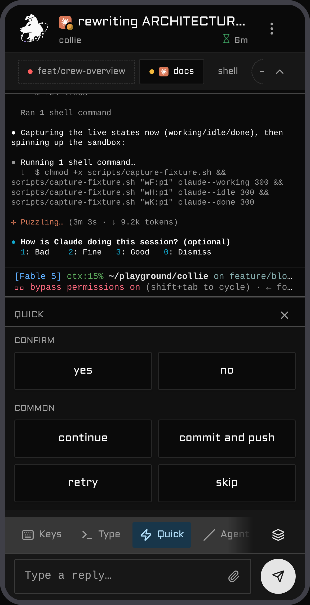
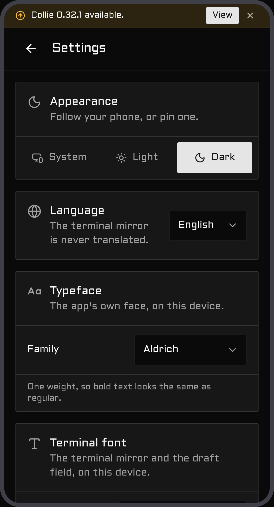

# ColliePWA

<p align="center">
  <!-- Baked by collie-brand's link-card.ts (assets/collie-link-card.png) and copied in whole, the
       same file colliepwa.dev serves as its social card. Do not retouch it here: regenerate it there. -->
  
</p>

<p align="center">
  <a href="https://colliepwa.dev/demo?utm_source=github&amp;utm_medium=readme&amp;utm_campaign=collie&amp;utm_content=hero"><b>Try it in your browser — no install</b></a> ·
  <a href="https://colliepwa.dev/?utm_source=github&amp;utm_medium=readme&amp;utm_campaign=collie&amp;utm_content=hero">colliepwa.dev</a><br>
  <sub>A real Collie build running in the page against faked data.</sub>
</p>

ColliePWA is an open-source (MIT) web app for your phone. It displays your terminal AI agents,
including Claude Code, Codex and OpenCode, and lets you answer them remotely. You host it on your
own computer alongside [Herdr](https://herdr.dev). Support for the new Herdr core,
[tmux](https://github.com/tmux/tmux) and [zellij](https://zellij.dev) is experimental. ColliePWA
is served over Tailscale, so only devices on your own tailnet reach it. You install it via your browser
directly to your home screen, bypassing app stores.

Using Herdr? Read about the
[Herdr mobile client](https://colliepwa.dev/herdr-mobile-client?utm_source=github&utm_medium=readme&utm_campaign=collie&utm_content=herdr).

## What you can do

- **Answer what needs you.** The dashboard surfaces waiting agents first. Agent prompts turn into
  buttons. Quick replies, a configurable keys board, and your system keyboard with voice
  dictation handle input. [Guide](./docs/claude-code-on-your-phone.md)
- **WalkyTalky: agents message each other, and you message them.** Send short messages between
  agent sessions across programs and machines. Message any session from your phone. Every message
  returns a receipt. [WalkyTalky](./docs/walky-talky.md)
- **Start agents from the phone.** Use the **+ New** page to choose the machine, agent or
  command, directory, and an optional git worktree. [Guide](./docs/claude-code-on-your-phone.md)
- **Push notifications and voice input.** Receive alerts when an agent pauses or finishes.
  Whistle, Collie's built-in speech engine, converts voice to text. It remains inactive until
  configured. [Voice and push](./docs/voice-and-push.md)
- **See what the agent changed.** The Files view displays the workspace folder, marks modified
  files, and provides a read-only view of git diffs and the latest commit. [Changes](./docs/changes.md)
- **Crews.** Cluster multiple Collie hosts behind one URL with manual failover.
  [Crews](./docs/crew.md)

Other features: output search, full conversation history, image and file attachments,
[durable agents](./docs/durable-agents.md) (experimental), four [themes](./docs/themes.md), twelve
languages, and per-device typeface selection. The Edge release line typesets chat equations when
math is enabled ([syntax](./docs/changes.md#equations)). Edge receives features before Stable
([Manage & update](./docs/upgrading.md)).

## Get it on your phone in 3 steps

Prerequisites: [Tailscale](https://tailscale.com) on your computer and phone, and
[Herdr](https://herdr.dev) (or experimental Herdr core, tmux, or zellij) running on your computer.
For new setups, follow **[Install in five minutes](./docs/five-minute-install.md)** for
platform-specific instructions, including [Windows](./docs/five-minute-install.md#windows).
Alternative options (Arch, Nix, Herdr plugin, source) are in **[Install](./docs/install.md)**.

**1. Install** on your computer. Requires `curl`, `tar`, and a sha256 utility. Needs no `sudo` or
compiler. Verifies checksums automatically:

```bash
curl -fsSL https://colliepwa.dev/install.sh | sh
```

**2. Start** it on your tailnet:

```bash
COLLIE_MUX=herdr collie start          # or: herdr-core, tmux, zellij
```

Without `COLLIE_MUX`, `collie start` checks for Herdr, tmux, and zellij and prompts you to pick
one. It offers Herdr core only if the Herdr TUI is absent.

**3. Put it on your phone and pair it.** Run `collie qr` and scan the code. Add ColliePWA to
your home screen:

- **iPhone:** In Safari, tap **Share** (under **⋯** in the default iOS 26 layout), tap
  **Add to Home Screen**, then tap **Add**.
- **Android:** In Chrome, open Collie **Settings** and tap **Install** on the top card.



ColliePWA is not on the App Store or Google Play; home-screen installation is required. Launch the
installed app, run `collie pair` on your computer, and enter the code under
**Settings → System → Paired devices**. Pair within the home-screen app, not the browser: iOS keeps
their storage separate. The app displays no panes until paired.

Agents awaiting input appear first. Tap an agent to reply. To configure Collie using an agent,
instruct it to run `collie skill` and follow the instructions.

> Collie exposes remote shell access to your machine. Keep it on your tailnet (`tailscale serve`,
> never `funnel`). Read [Security](#security-read-this-first) before running.

## Security, read this first

**Collie provides remote shell access to your machine by design.** A single Collie API call sends
arbitrary keystrokes directly into a live terminal pane. Anyone with access to the URL can read pane
output (source code, secrets, environment variables, agent output) and execute arbitrary commands
with your full user privileges. There is no sandbox and no command allow-list, as these would defeat
the core workflow. Treat the URL as a root login: bind it strictly to your tailnet, set
`COLLIE_TRUSTED_USER`, and pair only the physical phone you are using. Read
[`docs/security.md`](./docs/security.md) for details on the security model, defense layers, and
device gating before running the service.

> **Never `tailscale funnel` this.** `funnel` exposes the port to the public internet, whereas
> `serve` limits access to your private tailnet. Do not funnel Collie under any circumstances.

## Who this is for

Collie is for developers running terminal-multiplexed AI agents who want phone access via a touch
UI instead of an emulated terminal. Herdr is the primary target. **The Herdr core, tmux and zellij
are experimental**: they function, but testing is limited.
[Bug reports are welcome](./docs/multiplexers.md#pointing-collie-at-a-multiplexer), including reports
of working setups.

The setup assumes a **[Tailscale](https://tailscale.com) tailnet**, with `tailscale serve` as the
default ingress. Collie is strictly **single-user**: one operator per tailnet, without multi-tenant
authentication. Do not deploy it for shared or public access.

## Demo

The [interactive demo](https://colliepwa.dev/demo?utm_source=github&utm_medium=readme&utm_campaign=collie&utm_content=demo-section)
runs the client in your browser against mock data without requiring installation.

<table>
  <tr>
    <td align="center" width="50%"><br><sub><b>Dashboard</b>: every pane stays in its workspace, what needs you is marked in place</sub></td>
    <td align="center" width="50%"><br><sub><b>Ask</b>: the agent's own prompts become tappable buttons</sub></td>
  </tr>
  <tr>
    <td align="center" width="50%"><br><sub><b>Space</b>: its tabs and panes, deep-linkable</sub></td>
    <td align="center" width="50%"><br><sub><b>Keys</b>: the special-keys pad, arranged the way you work</sub></td>
  </tr>
  <tr>
    <td align="center" width="50%"><br><sub><b>Quick</b>: your own one-tap replies, from <code>quick-replies.toml</code></sub></td>
    <td align="center" width="50%"><br><sub><b>Settings</b>: appearance, language, typeface, per device</sub></td>
  </tr>
</table>

## Documentation

### Guides

| | |
| --- | --- |
| [**Install in five minutes**](./docs/five-minute-install.md) | The recommended setup, step by step: Tailscale, Herdr and Collie on your computer, then a paired phone with Collie on its home screen |
| [**Claude Code in tmux or Herdr, on your phone**](./docs/claude-code-on-your-phone.md) | Keep Claude Code running in tmux or Herdr when SSH drops. Manage sessions, start new agents and worktrees, approve prompts, and send Esc or Ctrl from your phone with push alerts. |
| [**WalkyTalky**](./docs/walky-talky.md) | Messages between agent sessions: `collie walky who`, `send`, `reply`, `inbox` and `status`, pane tokens, receipts, how a message crosses a crew and how its outcome comes back, the phone's cards and composer, installing the skill into your agents, and the limits |

### Sessions

| | |
| --- | --- |
| [**Sessions**](./docs/sessions.md) | What a session is, where sessions come from, a terminal or a durable agent, and what the phone shows for each |
| [**Terminals**](./docs/multiplexers.md) | Pointing Collie at Herdr, the Herdr core (`herdr-core`), tmux, zellij, tuios or Tern, what each can answer, two Collies on one machine, and agent beacons. Experimental for the Herdr core, tmux, zellij, tuios and Tern; bug reports wanted |

### Durable agents

| | |
| --- | --- |
| [**Durable agents (experimental)**](./docs/durable-agents.md) | Show your own durable agent on your phone: the quickstart, `collie durable attach` and `sources.json`, the three verbs, tokens, the files Collie keeps, and the versions |
| [**Durable agents on the phone**](./docs/durable-agents-on-the-phone.md) | What a durable agent's section, conversations, questions and receipts look like |
| [**Troubleshooting a durable agent**](./docs/durable-agents-troubleshooting.md) | A durable agent that does not show up or says Unreachable: the first checks, every reason and what fixes it, the doctor rows, and the cases that come up |
| [**Security of a durable agent**](./docs/durable-agents-security.md) | What a durable agent can and cannot do, the trust rules of the socket and of the token, what Collie does to a durable agent's text, and what the audit log keeps |
| [**The durable SDK (experimental)**](./docs/durable-sdk.md) | The npm package `@colliepwa/durable-sdk`, part by part: its entries and runtimes, `openCollie`, the pane methods, the four kinds of question and `requireApproval`, hooks, history, caps, the helpers, the Pi glue and the versions |
| [**The durable wire (experimental)**](./docs/durable-wire.md) | What travels between Collie and a durable agent, for a builder: the routes, hello and the epoch, the life of an ask and the request ids, the socket and token transports, the limits and the version rule, with a link to `WIRE.md` for the exact rules |

### Reference

| | |
| --- | --- |
| [**Install**](./docs/install.md) | The front door you need, then the install for your system: Linux, Arch and Omarchy, Nix, macOS, Windows, or as a Herdr plugin. Covers first run, setup on an iPhone or Android phone, updates, and uninstallation |
| [**Windows**](./docs/windows.md) | Windows 11 with Herdr: what is supported and what is still experimental, installing with `install.ps1`, the unsigned binary, updating, long paths, and what is not tested |
| [**Security**](./docs/security.md) | What a Collie exposes, the defenses, and pairing a device, the credential for every request |
| [**Configure**](./docs/configure.md) | The `.env`, your own slash commands, keys, quick replies, launchers and typefaces; appearance, Zen mode, language |
| [**Themes**](./docs/themes.md) | The four looks Collie ships, picking one in Settings, importing a theme file after a preview, exporting one to edit, and writing your own: the 43 colour tokens, the shape and look words, the terminal palette, and what a theme cannot change |
| [**Changes**](./docs/changes.md) | The Files screen: a workspace's folder with its changes marked, the changed files and their diffs, and the last commit, from the pane or the dashboard's Files tab. Read-only git, nested repos, and the two settings that decide how far it looks |
| [**Deployment**](./docs/deployment.md) | Front doors other than the default: an identity-aware proxy, a reverse proxy with no Tailscale, an off-host ingress, several Collies on one host (one per user, or several instances for one user), and a crew's standby door |
| [**Commands**](./docs/commands.md) | Every `collie` verb, the census verbs that show what a Collie knows (`status`, `mux list`, `sessions`, `crew status`), putting `collie` on your PATH, and the Herdr actions that mirror the verbs on a Herdr-managed install |
| [**Crews**](./docs/crew.md) | Several machines' Collies behind one URL: invite, join, deputy, failover, and a machine that runs several Collies |
| [**Voice input and Web Push**](./docs/voice-and-push.md) | The microphone in the composer, Whistle speech to text on your phone or your computer, and notifications when an agent is waiting on you |
| [**Manage & update**](./docs/upgrading.md) | Update from the phone or the terminal, roll back, update a crew, cross a major, stop, uninstall, and upgrading a 0.x install to 1.0 |
| [**Troubleshooting**](./docs/troubleshooting.md) | Symptoms in the words you would actually search for |
| [**Terminology**](./docs/terminology.md) | Collie's words in plain words, beside the names other tools use: session, space, tab, pane, terminal, durable agent, harness, crew, lead, and more |
| **For an AI coding agent in your terminal** | `collie skill` prints a brief on how Collie works, and `collie docs` prints the pages above, both out of the binary and with no network |

Root specifications: [`ARCHITECTURE.md`](./ARCHITECTURE.md),
[`MUX_CONTRACT.md`](./MUX_CONTRACT.md), [`CREW_PROTOCOL.md`](./CREW_PROTOCOL.md),
[`HERDR_API.md`](./HERDR_API.md), [`HC_API.md`](./HC_API.md), [`DESIGN.md`](./DESIGN.md),
[`HARNESS_CONTRIBUTING.md`](./HARNESS_CONTRIBUTING.md), and [`CONTRIBUTING.md`](./CONTRIBUTING.md).

## Deployment variants

Collie always binds to **loopback only**. Deployment types differ by ingress configuration and
authentication mechanism. Variant A is default. See [`docs/deployment.md`](./docs/deployment.md)
for variants B through E.

### Variant A — `tailscale serve` + person identity (default)

Standard path from [Install](./docs/install.md#install). `tailscale serve` terminates TLS on your
MagicDNS domain and injects `Tailscale-User-Login`, a header a client cannot forge through the proxy. Define
`COLLIE_TRUSTED_USER` in `.env` to restrict access:

```bash
COLLIE_TRUSTED_USER=you@example.com
```

This trusts the tailnet user, not the device. For device-level security,
[pair the device](./docs/security.md#pair-a-device--the-write-credential). Use alternative variants
only for proxy setups or environments without Tailscale:

- **[B, identity-aware proxy, authorised by device](./docs/deployment.md#variant-b--identity-aware-proxy--per-device-authorisation):** Host-level proxy with role-based access.
- **[C, reverse proxy as the only front door](./docs/deployment.md#variant-c--reverse-proxy-as-the-only-front-door-no-tailscale):** Direct reverse proxy without Tailscale.
- **[D, off-host identity proxy over the tailnet](./docs/deployment.md#variant-d--off-host-identity-proxy-over-the-tailnet):** Shared ingress node routing traffic to Collie and other systems.
- **[E, any other mesh or tunnel](./docs/deployment.md#variant-e--any-other-mesh-or-tunnel-netbird-zerotier-cloudflare-tunnel):** Custom network tunnels (NetBird, ZeroTier, Cloudflare Tunnel).

## Windows

```powershell
irm https://colliepwa.dev/install.ps1 | iex
```

Windows 11 x64 running Herdr is maintained and tested directly. The platform stays labelled
experimental until an update between two real releases is proven on it. Linux and macOS are unaffected. See
[**docs/windows.md**](./docs/windows.md) for installation, updates, and limitations. Summary:

- **Tested.** The `windows.yml` workflow tests the bridge, CLI, and scripts on every push. A
  Windows 11 VM rehearses an install, an update and a rollback before each release tag
  ([ADR 0075](./.adr/0075-windows-is-a-supported-host.md)).
- **Installed without a toolchain.** Releases provide `collie-<version>-windows-x64.zip`,
  installed via `scripts/install.ps1`. The binary is unsigned and may trigger Smart App Control.
- **Run by Task Scheduler.** Commands `collie start`, `stop`, `restart`, `status`, and `uninstall`
  work normally. The service runs as task `herdr.collie` at user login.
- **Not covered.** tmux and zellij (no Windows binaries), Windows 10, Windows on ARM, and
  a Windows machine in a crew without the [experimental](./docs/windows.md#crews) consent flag.
  Herdr action buttons require `bash`, limiting manifest support to `linux` and `macos`.

Herdr on Windows uses a named pipe for its control socket. Collie connects through `node:net`
via [`bridge/dial.ts`](./bridge/dial.ts), which details the path mapping. The socket defaults to
`%APPDATA%\herdr\herdr.sock`; override it with `HERDR_SOCKET_PATH`. Setting
`COLLIE_HERDR_DIAL=net` enables this dialer on Linux and macOS for testing without Windows.

## Architecture

A Bun process bridges your phone and your terminal multiplexer. The browser never connects to the
multiplexer directly.

```
  phone (PWA)
     │  HTTPS over the tailnet
     ▼
  tailscale serve        terminates TLS, injects the identity header
     │  127.0.0.1:PORT    (the bridge binds loopback only)
     ▼
  Collie bridge (Bun)    serves the UI + a small JSON API; polls the multiplexer
     │  one mux adapter, chosen per install
     ▼
  the multiplexer        owns the panes, agents and terminal state
  Herdr · Herdr core · tmux · zellij
```

Under [Variant C](./docs/deployment.md#variant-c--reverse-proxy-as-the-only-front-door-no-tailscale),
a standard reverse proxy replaces `tailscale serve`. The downstream components are unchanged.

- **Only the adapter touches the multiplexer** (`bridge/mux/<name>/`: Herdr dials a Unix socket, tmux and zellij shell out to their CLIs); everything else speaks the bridge's HTTP API. What every adapter must answer is [`MUX_CONTRACT.md`](./MUX_CONTRACT.md).
- **Polling is still the model.** The bridge takes one snapshot per tick from the adapter and the browser polls `/api/snapshot`; where the multiplexer offers an event stream (Herdr does) it only pokes the bridge's poll to go faster, it never replaces it. No resync logic.
- **Actions are plain HTTP.** A reply or key `POST`s to `/api/pane/:id/{reply,keys}`, and the adapter types it into a real terminal (hence the security posture).
- **The UI is a static PWA.** Vite builds `web/dist`, served from disk, so a rebuild is live with no restart.
- **A second Collie is a peer, not a second bridge.** One machine's bridge mirrors one multiplexer, and a lead reads its peers over the crew link ([`CREW_PROTOCOL.md`](./CREW_PROTOCOL.md)).

Read [`ARCHITECTURE.md`](./ARCHITECTURE.md) for full design rationale.

## Developing

Clone and build the repository
([Install, the same result from source](./docs/install.md#the-same-result-from-source)), then edit
the code.

- **Every verb is implemented once, in `cli/`,** and runs as `bin/collie <verb>`
  ([Commands](./docs/commands.md)). `scripts/collie-ctl.sh` is a bootstrap shim that compiles the
  binary and passes your argv. The Herdr adapter's `herdr-plugin.toml` is a thin registration file
  whose `[[actions]]` call that shim ([Herdr actions](./docs/commands.md#herdr-actions)).
- **Development loop:** `web/` rebuilds appear at once, because the bridge serves `web/dist` from
  disk. Changes to `bridge/` need a restart (`systemctl --user restart collie`). Build, test and
  versioning rules live in [`CLAUDE.md`](./CLAUDE.md), and git hooks enforce versioning, so read it
  before you commit.
- **Checks:** `bun run typecheck`, `bun run lint`, `bun test ./bridge ./cli ./scripts`, and in
  `web/` `bun run typecheck` and `bun run test`. [`CONTRIBUTING.md`](./CONTRIBUTING.md) has the
  full list.
- **Multiplexer adapters:** [`MUX_CONTRACT.md`](./MUX_CONTRACT.md) defines the interface an adapter
  must implement, and [`MUX_CONTRIBUTING.md`](./MUX_CONTRIBUTING.md) covers the integration
  boundaries. [`ARCHITECTURE.md`](./ARCHITECTURE.md) §3 explains why Collie runs as a supervised
  service instead of an embedded pane. An agent program that Collie should read needs a harness
  profile: [`HARNESS_CONTRIBUTING.md`](./HARNESS_CONTRIBUTING.md).
- **Pull requests:** open them against `main`. [`CONTRIBUTING.md`](./CONTRIBUTING.md) has the CI
  checks and the version rules.

### The states playground

A local test page renders UI components across mock states (boot, idle, dashboard, crew,
settings) without active agents. The tab shows a red icon to identify it as test-only.

```
cd web && COLLIE_DEV_HOSTS=bluefin,localhost bun run playground
```

Open `http://<host>:5199/playground.html`. Port 5199 disables `/api` calls to ensure it never hits
a live instance. `bun run playground:build` outputs the test assets to `web/dist-playground/`
without touching `dist/`. The view shows one section at a time, tracked via the URL hash (`#pane`,
`#pane/<card-handle>`, `#changes:one-file`). Add states by adding a `<Card>` to a `Group` in
`web/src/playground/sections/` and mock entries to `web/src/playground/fixtures.ts`. Add sections
by exporting `DEF` and a component from a new file, then register it in `SECTIONS` inside
`web/src/playground/app.tsx`. Use `Round` (`web/src/playground/round.tsx`) to evaluate layout variants.

For Herdr adapter development, refer to upstream documentation for the plugin system:
[authoring](https://herdr.dev/docs/plugins/) ·
[CLI reference](https://herdr.dev/docs/cli-reference/) ·
[example plugins](https://github.com/ogulcancelik/herdr-plugin-examples). Collie's socket
integration is documented in [`HERDR_API.md`](./HERDR_API.md).

## Telemetry

New in 1.27.0 and on by default. Up to 1.26.x Collie sent nothing about your install
([ADR 0129](./.adr/0129-an-anonymous-install-count-on-by-default.md)). Once a day each bridge (one
instance with its own state folder) sends one small ping to `ping.colliepwa.dev`: a random ID made
on your machine, the day, the version, the OS, the CPU, the install kind, the release line (Stable
or Edge) and whether the bridge runs alone, leads a crew or is a member. When a trouble card showed
("Cannot read a dialog" or "Send not landing"), it also carries a count: which card, the agent
program's name and version, the multiplexer and, from 1.27.4, for a dialog a short hash of its
key-hint row. No IP address is stored. No usage, no content, nothing you type or read.

Turn it off on each machine in Settings, System, **Telemetry**, with `COLLIE_TELEMETRY=0` (in the
instance's `.env` for a service), `telemetry = false` in `config.toml` or `DO_NOT_TRACK=1`. Blocking
the host in your firewall works too. The update check is a separate anonymous request to GitHub's
public tags API. [Details](./docs/security.md#what-leaves-your-machine) ·
[exact message](./telemetry/README.md)

## See also

- All how-to pages: [`docs/`](./docs/)
- Architecture and design rationale: [`ARCHITECTURE.md`](./ARCHITECTURE.md)
- Multiplexer query interface and capabilities: [`MUX_CONTRACT.md`](./MUX_CONTRACT.md)
- Lead-to-peer crew protocol: [`CREW_PROTOCOL.md`](./CREW_PROTOCOL.md) (topology diagram in
  [§2](./CREW_PROTOCOL.md#2-shape-of-the-thing))
- Crew recovery from a phone after lead failure:
  [`docs/deployment.md`, the standby door](./docs/deployment.md#the-standby-door--a-crews-failover-path)
- Verified Herdr socket API: [`HERDR_API.md`](./HERDR_API.md), and for the Herdr core
  [`HC_API.md`](./HC_API.md)
- Operations, versioning, and project conventions: [`CLAUDE.md`](./CLAUDE.md)
- Contribution guidelines: [`CONTRIBUTING.md`](./CONTRIBUTING.md)
- Names, logo and forks: [`TRADEMARKS.md`](./TRADEMARKS.md)
- Release history: [`CHANGELOG.md`](./CHANGELOG.md)
- Third-party code: the Whistle speech engine, `needle` by Cactus Compute (Apache-2.0), is vendored in
  [`web/public/stt/`](./web/public/stt/needle-3-93e88ede/LICENSE)
