# Crew commands

A **crew** is several machines running Collie under one **lead**, and your phone reaches every
machine's herd through the lead's single URL. The lead is the machine your phone reaches, every
other machine is a member, and the deputy is the one member allowed to take over.

| Command | What it does |
| --- | --- |
| `collie crew invite` | Mint a single-use, 10-minute enrollment token (**on the lead**) |
| `collie crew add <ssh-host>` | Install and enroll a peer over **your own SSH** (on the lead) |
| `collie crew update <member>… \| --all` | Preflight every machine, then the lead, then each peer one at a time over **your own SSH**; the first failure stops the run ([details](upgrading.md#updating-the-rest-of-the-crew)) |
| `collie crew status` | Mode, members, reachability, each member's version, mux and pane count, secret pickup, and why a link is refused (`--json` for a program) |
| `collie crew rotate` | Reissue the crew secret and hand it to every reachable peer |
| `collie crew rename <name>` | Give the crew a new name (**on the lead**) |
| `collie crew remove <member>` | Unpin and forget a member (on the lead) |
| `collie crew set-address <member> <host:port>` | Correct where this lead dials a member |
| `collie crew deputy <member>` | Name the ONE peer that may take over, and arm it; `--revoke` names nobody |
| `collie crew approve-promote <member>` | Consent, on the lead, for one member to take over, 10 minutes, single-use; `--cancel` clears it |
| `collie crew join <lead-address> [<token>]` | Join a crew (**on the joining machine**); without a token it prompts for one, or pass `-` for stdin or `@file` |
| `collie crew leave` | Leave the crew; drops the crew secret and the pinned certificate of every other member on this machine |
| `collie promote` | Make THIS machine the lead (on the peer taking over; `--force` if the lead is gone) |
| `collie reconnect` | A member moved: re-point at its new address without re-enrolling anything |

`collie join` and `collie leave` still work. They are aliases for `collie crew join` and
`collie crew leave`, using the same arguments and exit codes.

`collie pack` still works too, for every verb in this table. It is an alias of `collie crew` with
the same arguments and exit codes. `collie docs pack` prints this page, and the web app's `/pack`
address redirects to `/crew`. All three go away in 2.0.0
([ADR 0038](../.adr/0038-the-group-is-a-crew-the-wire-keeps-pack.md)).

The `deputy`, `approve-promote`, and `promote` commands manage failover. For setup and recovery
instructions, see
[`docs/deployment.md` → the standby door](deployment.md#the-standby-door--a-crews-failover-path) and
[the bad day](deployment.md#the-bad-day--the-runbook).

## Two machines, one crew

Two commands add a machine, one for Herdr and one for Collie, and a manual path is there for a host
`crew add` cannot ssh into and for a lead that serves plain HTTP.

```bash
herdr machine add --label <name> <ssh-target>   # prepare a host with the Herdr TUI
hc machine add --install <ssh-target>           # or prepare it with the Herdr core
collie crew add                                 # pick machines, one confirm each
```

Run one of the first two lines, not both. `herdr machine add` and `hc machine add` run on the machine
you sit at. Each one puts its Herdr on the remote host and saves the machine in its own list. Neither
one adds the machine to the crew. `collie crew add` runs on the lead. `<ssh-target>` is written as
`user@host` or as a `Host` alias from your `~/.ssh/config`.

`collie crew add` with no host lists the machines your ssh config, Herdr and the Herdr core know. It
merges them on the host each name resolves to ([below](#herdr-machines-and-the-crew)). Type the
numbers or the names of the machines you want, separated by spaces or commas, or type `all`. Each
machine then gets its own confirm, after Collie has probed it and before anything is written there.
The confirm names the machine, the `user@address` ssh will dial, and the member id, for example
`Add minibuch (altan@minibuch) to this crew as "minibuch"?`, so a Herdr name that leads to another
address shows before you say yes. With no terminal to answer, every picked machine reads as No:
`crew add` prints `✗ declined (no terminal to confirm)` and exits non-zero. A host you type on the
command line is never asked. Press Enter on a blank line to stop.

```bash
collie crew add            # no host: the list
collie crew add <ssh-host> # one named host, no list
```

A picked machine joins under the name Herdr gives it, so the phone shows the same names as
`herdr machine list` and `hc machine ls`. `--label <name>` sets another name, for one machine only.
With several picks, `--label` and `--peer-address` are refused, and each machine is asked for its
own address. A machine the core reaches with a command of its own (`hc machine add --via`) shows in
the list with `cannot be added:` and a reason that says what to do, for example `reached through
altan@10.0.0.7; add altan@10.0.0.7 first, or type its address`, and you cannot pick it. A sandbox is
not listed at all. A name in a list that ssh could read as an option, or that holds a space, shell
syntax or a control character, is refused with `refused: Herdr machine name "..." is not a valid
host` and left off the list. Typing a host on the command line always works.

`collie crew add <ssh-host>` installs Collie on the remote host over your own ssh and enrolls it. It
generates the token locally, provisions Collie on the remote machine, and runs `collie crew join`
there. The remote host needs **Herdr or the Herdr core**, and one of the two is enough. A member with
only the core joins like any other, and it runs on `herdr-core`. A lead that serves plain HTTP needs
one more step by hand, because `crew add` does not support `--insecure`: run `collie crew join
--insecure` on the joining machine. Use either `crew add` or the manual path for a given host, never
both.

When the run ends, `crew add` says which multiplexer the member runs on, for example "and runs on
herdr-core". With several picks it ends with one line per machine: the member id and the
multiplexer it runs on, or the reason it did not join. A machine that fails does not stop the next
one. The last line counts them: `joined 2, declined 1, failed 0`. Any failure makes the exit code
non-zero. With no failure it is 0 when something joined, and 3 when nothing did, for example when
you declined every machine.

`collie crew remove` is local, so a machine you removed still answers as a member until you run
`collie leave` there. `crew add` does not call that machine a member. It prints `✗ not joined`, says
to run `collie leave` on it and add it again, and exits non-zero.

`crew add` takes the route its own install kind names. A lead that runs from a git checkout, as the
Herdr plugin install does, pushes its own commit to the member and builds it there, so that member
needs `git` and Bun. A lead from the [standalone install](install.md#standalone) or from a package
has no commit, so it installs the member from the release it runs itself, with Collie's own
installer sent over the same ssh, and that member needs `curl`, `tar` and `sha256sum` or `shasum`
instead. `--path` names the remote checkout on the first route and the install root on the second.
A member that already runs the other kind of install is refused rather than written over, and the
refusal names the one command that resolves it. On that second route the member downloads the
release from github.com itself, so a member with no route to github.com needs a lead that runs from
a checkout.

The terminal `collie crew update` takes the same two routes, and reads the same fact to pick one: a
checkout lead pushes its own commit to each member, and a lead from the standalone install or from a
package levels each member to the release it runs itself. On a release lead, a member running from a
git checkout is skipped with the one command that moves it named on its row, `collie update --to-tag
v<version>` on that machine. On a checkout lead, a member installed by install.sh is skipped the
other way round: it takes releases, so the phone's Updates page levels it. A skipped member never
stops the run, and the confirm counts it apart.

The manual path is four commands. Use it for a host your ssh cannot reach, or for a lead that
serves plain HTTP, and not because of the lead's install kind: every kind of lead adds a member with
`crew add`. The lead is the instance your phone already reaches, and the joining machine must have
Collie installed and running.

1. On the lead, mint the token.

   ```bash
   collie crew invite        # prints the token, and the join command to run on stderr
   ```

   The token is one line: `<token>.<lead-fingerprint>`. It is the only thing on stdout. The restart
   lines and the join command go to stderr, so `collie crew invite | ssh member 'collie crew join <address> -'` works.

2. On the joining machine, join the crew and paste the token when it asks.

   ```bash
   collie crew join https://lead.tail1234.ts.net
   ```

   Copy the address from the `invite` output. It is your lead's own, not this example.

3. On the lead, restart it so the running process picks up the new member.

   ```bash
   collie restart
   ```

4. On the lead, check that the link answered.

   ```bash
   collie crew status        # the new member, its address, and whether the link answered
   ```

Tokens are single-use, valid for ten minutes, and displayed once. The lead stores only the hash.
Running `invite` restarts the lead process so it can accept the incoming enrollment. It waits until
the restarted lead answers, for up to 30 seconds, and only then prints the token and the join line
with the lead name included. If the lead does not answer in that time, `invite` says so and prints no
join line, because a `join` would be refused while the lead is down. Check `collie logs`, then run
`invite` again. The token is the first line of stdout, and the restart notice goes to stderr, so a
script can read the token from the first line. A `join` that is refused with "the lead refused the
token" shortly after an `invite` can also mean the lead is still restarting.

Step 3 is a second restart, and `join` says so on the way out. `invite` restarted the lead so it
could accept the enrollment. `join` then wrote the new member to disk, and the running process does
not proxy traffic to that member until it is restarted again.

In an interactive terminal, `join` prompts for the token. In a script, pass `-` and provide the
token on stdin:

```bash
collie crew join https://lead.tail1234.ts.net -   # paste the token on stdin
```

Pass `@<file>` instead to read the token from disk. Passing raw tokens directly as arguments
prints a warning, because process listings expose arguments to all local users
([`CREW_PROTOCOL.md` §8.3](../CREW_PROTOCOL.md)).

Set the lead address to any hostname or `host:port` reachable from this node. An address without a
scheme and port resolves to `https://<host>:8787`, the port Collie's own listener binds. A port you
type is kept: `host:443` dials `https://host` on port 443, and `host:8788` dials port 8788.

What `crew invite` prints depends on how the lead is published. In the default HTTPS mode, the lead
listens on loopback and `tailscale serve` publishes it on port 443. So `invite` prints
`https://<full-tailnet-name>`, which dials port 443. A lead published on 443 through
`COLLIE_PUBLIC_URL` prints `https://<host>` the same way. If you moved the front door with
`COLLIE_SERVE_PORT`, it prints `<name>:<port>`. With `COLLIE_SERVE_MODE=http` the lead's own
listener answers on port 8787 over plain HTTP, and `invite` prints the short name, with the port
only if you changed it. `join` prompts once before sending the token over plain HTTP, and
`--insecure` confirms this automatically. An explicit `http://` address still requires `--insecure`
and prompts for nothing.

`crew add` hands the member the same front door, so the member dials port 443 too. A bare name
would mean port 8787, which a lead behind `tailscale serve` does not open to the tailnet.

`--address` on `crew join` is the address the lead dials this machine at, and it needs a port:
`--address <host>:8787`. `join` refuses one without a port, because the lead would dial port 443.
An `https://host:8787` address is still accepted and stored as `host:8787`.

**A second instance on the same host** joins with `--address 127.0.0.1:<port>`, where `<port>` is that
instance's own port:

```bash
collie crew join https://lead.tail1234.ts.net - --address 127.0.0.1:8788
```

**Every machine has its own name.** `--label <name>` is the name a member shows in the crew. Without it, a
member takes the host name. A named instance (`COLLIE_INSTANCE=hc`) takes `<hostname>-<instance>`, so a
second instance on the lead's host joins as `bluefin-hc`, not as a second `bluefin`. The lead refuses a
name that is its own, or one that another member already has, with a reason like `the name "bluefin" is
already taken by the lead. Pass --label <another name>.` The match ignores capital letters. The lead has
spent the invite by then, so run `collie crew invite` again and join with another `--label`. A member that
joins again under its own name is not refused. This needs a lead on 1.25.0 or later. An older lead
still adds a random suffix to a name that is taken.

A member's listener is pinned mutual TLS, so a browser or `curl` cannot reach it directly. You reach
that member only through the lead.

**Multiplexer selection is local to each node.** Configure `COLLIE_MUX` in that node's own `.env`,
at `~/.config/collie/.env` on a binary install or in Herdr's plugin config dir on a Herdr install.
The crew protocol, which is the wire between the machines, contains no multiplexer-specific fields.
Note that peers have only been tested with Herdr in v1
([`CREW_PROTOCOL.md` §16](../CREW_PROTOCOL.md)).

`crew add` settles that value for a new member, because the member cannot always settle it itself. A
member that runs exactly one multiplexer is left alone, and picks that one at its own first start. A
member that runs several is a question the lead asks you, and your answer is written as `COLLIE_MUX`
in that member's `.env`. A member that already names one is left alone too. Pass `--mux <name>` to
answer ahead of time, or to replace a name the member already carries. A member with no multiplexer
running gets a warning and nothing written, because its first start refuses until one runs.

## Herdr machines and the crew

Herdr's saved machines and a Collie crew are two separate lists. Herdr's list only suggests machines
to the crew, and the crew stays yours.

To add a machine, see [Two machines, one crew](#two-machines-one-crew) above.

Herdr's machine list belongs to your Herdr window. Herdr 0.9.0 keeps saved ssh targets in its
client and opens each one over ssh every time you use it. You get terminals on those machines, in
that window, on the machine you are sitting at.

A crew is Collie on every machine, and the lead reaches each member over Collie's own encrypted
link, set up once by an install that rides your ssh. A crew shows terminals too, and it carries more
than terminals. It moves uploads. It keeps each machine's journal and audit log on the machine that
ran the pane. It updates the whole crew from one confirm on the phone. It can hand the front door to
a deputy when the lead goes quiet. It works the same under tmux and zellij, which have no machine
list at all.

| what | Herdr's machine list | a Collie crew |
| --- | --- | --- |
| Who makes the link | your Herdr client | the lead Collie |
| What carries it | ssh, on every use | Collie's own encrypted link |
| What you see | terminals | terminals, uploads, journal, audit log, updates, failover |
| Where you see it | your Herdr window | your phone |
| Works with tmux and zellij | no | yes |

Three facts keep the two lists apart, and each one is a reason on its own.

The phone never holds an ssh key. An ssh key is a full shell on the machine, and a phone gets lost.
The phone holds a pairing token the lead issued instead, which opens the app and nothing else, and
`collie devices revoke <label>` kills that code live, with no restart
([pair a device](security.md#pair-a-device--the-write-credential)).

Uploads, the journal and the audit log live on the machine that runs the pane. And the crew link,
which is what Collie calls the encrypted line between two machines, needs no ssh once a member has
enrolled.

So you do not set the same thing up twice. You set up ssh once, and both tools use it. Herdr keeps
its list for its own window, and Collie keeps the crew for your phone. Adding a machine to Herdr
does not add it to the crew. Removing it from Herdr does not remove it from the crew. A crew member
running tmux or zellij never appears in Herdr's list.

`collie crew add` with no target offers candidates from three sources, so you never type a host
twice. It reads `Host` entries in your `~/.ssh/config`, runs `herdr machine list --json`, and runs
`hc machine ls --json`. It merges the lists on the ssh target each name resolves to. The command
follows an `Include` in that config one level deep, and only for paths under `~/.ssh/`. It does not
offer an alias in a file included from an included file. Each row shows where the name came from:
`ssh config`, `herdr`, `herdr-core`, or several. A row for a machine already in this crew carries
that member's id instead of a number. Only the route `crew add` recorded for the member counts for
that. A member you joined by hand has no such route, so its row matches on the address the lead
dials it at, or on its member id, and says `may be enrolled as "id"` instead. That row keeps its
number, you can still pick it, and `all` skips it. A match on an address or a name cannot tell two
machines apart, so it never hides a row.

Two kinds of machine from the core are special. A sandbox is hidden. A machine the core reaches
with a command of its own is shown with `cannot be added` and the reason, because Collie installs
over ssh and has no way in. When that command is an `ssh` one, the reason names its destination. A tool that is not installed or not running adds no rows and prints nothing.

The crew stays your list. Herdr's list only suggests machines. Collie never adds a machine to the
crew without your pick and your confirm. Collie never removes a member on Herdr's say-so either.

Collie does tell you when the two lists differ. It prints one line for each case.

```text
herdr-core knows 1 machine that is not in this crew: vps.
Add it with `collie crew add`.
vps is in this crew, but herdr-core no longer lists it.
Keep it, or drop it with `collie crew remove vps`.
```

Each message is one line in the terminal. They are wrapped here.

The first line names the machines a list has and the crew lacks. The second line names a member that
a list suggested once and no longer names. `collie start` prints these lines after its banner,
`collie doctor` prints them as the `crew-candidates` check, and `collie crew status` prints them
under the members. They print nothing when the lists agree and nothing when a list is not running. A sandbox, a machine
the core reaches with its own command, and a machine that may be a member already do not count as
missing.
The lines read the lists on this machine and do not dial any other machine.

## How a crew is wired

Only the lead exposes a front door, and every other machine in the crew exposes none.



The lead is the managed front door, and it serves the PWA. The phone reaches it over HTTPS on
`/api/*` and talks to nothing else. The lead reaches each member on `/crew/v1/*`, over pinned mutual
TLS carrying the crew secret. A member is a full Collie with no front door, and it keeps its own
agents, journal, uploads and audit log. Management runs entirely through the CLI, with no Herdr UI
actions. The wire itself is specified in [`CREW_PROTOCOL.md`](../CREW_PROTOCOL.md).

A peer is one Collie instance, with one terminal multiplexer and the durable agents attached to it
([Durable agents in a crew](#durable-agents-in-a-crew)). A host with two terminal multiplexers runs one peer for
each. Each such peer has its own port and state directory, joins the crew on its own, and appears as
a machine of its own in the list.



Code rides your own ssh to every machine. `crew add` installs a member that way and `crew update`
levels it. The crew link carries runtime data, and it never becomes a distribution channel for Collie.

The code of a trick may cross the link only as inert data. It is held, never installed and never run,
until you tap on the screen of the machine that will run it. No machine of the crew can run a command
on another.

So an agent on a member can hand you a trick with `collie trick propose <folder>`. The files go to the
lead and wait there, unused, as a card on the Hill. Nothing runs until you tap "Switch it on" on that
card. `collie trick guide` tells an agent how to write a trick.



A deputy is one peer the lead named ahead of time. It binds a standby door with three routes, and
that door is never published. The lead's silence arms it, and your own pairing credential spends it,
so the phone can reach the deputy while the lead is gone.

The deputy keeps the crew's rows too: a read-only copy of the lead's launcher rows, which the New
screen offers once the deputy takes over.

## Durable agents in a crew

A member's durable agents show on the lead's phone, in the one Durable agents section, and the member's own
Collie answers for them.

```bash
# on a member that runs a durable agent beside Herdr, tmux or zellij: no second instance
collie durable attach desk --socket /run/user/1000/desk/app.sock --restart
# on a durable-only member that shares its host with another peer
collie crew join <lead-address> --label desk-agents
```

One Collie carries one terminal multiplexer and every durable agent attached to it, so a Herdr instance
and its durable agents are one peer, and it needs no label of its own. A durable-only instance
(`COLLIE_MUX=durable`) is a peer of its own. It joins under the host name unless you pass `--label` (a named
instance joins as `<hostname>-<instance>`), and the lead refuses a name that is taken, so give it a name when
another peer already uses that host.

| What | Where it happens |
| --- | --- |
| A durable agent's row | The lead's Durable agents section, with the member's name on it. The lead's own durable agents name no machine |
| The durable agent's card | The member tells the lead in its hello, so the phone reads it without asking again |
| The push for a question | The lead. A member in a crew sends no push for its own questions |
| The push caps | The lead, counted for each member and each durable agent ([Pushes from a durable agent](voice-and-push.md#pushes-from-a-durable-agent)) |
| An answer, a send, a stop, a belt action, a reopen and a starter tap | The member that owns the durable agent, forwarded by the lead |
| The receipt for each of those | The member. The lead keeps no copy, and a retry with the same request id replays on the member |

A lead older than 1.21.0 still lists a member's durable agents, but without the question card, and its
Terminal tab polls a pane that has no terminal. The member says so once in its log, and
`collie doctor` on the member shows the row `durable-lead`. Update the lead to fix it.

## Messages between machines

An agent can message an agent of its own space on another machine of the crew, and the lead relays every such message. A space of the same name on two machines is one space ([Your space](walky-talky.md#your-space)).

```sh
# every agent pane of your space, on every machine
collie walky who
```

A member sends the message to the lead. The lead checks the member's signature, then passes the
message on to the machine that the address names, and that machine checks the lead's. The lead also
sends the sender's certificate, so that machine checks the sender's signature too. A member's
`who` asks the lead for the crew's panes, and lists its own panes, with a note that other machines are the lead's to list, only when the lead does not answer. The lead learns the outcome of every message, and sends it back to the
member that sent it. Run `collie walky status <id>` on the sender's machine or on the lead
([Across a crew](walky-talky.md#across-a-crew)).

On the phone, a pane on a member shows its messages as a lead's own pane does. The lead reads the
list from that member's log, so the cards and the WalkyTalky sheet look the same on every machine
([On the phone](walky-talky.md#on-the-phone)).

On the phone, a message names the sessions and senders in it by name. In the terminal and in `collie walky who`,
the same message carries addresses and ids. The WalkyTalky skill asks an agent to write the full address of
any session it names, as `who` prints it, never a bare pane id, a window id or a label alone, so both
read well.

> **Note.** A member needs Collie 1.23.0 to take a message and to show its messages on the phone. A
> message to an older member is refused `not sent: older member`, and a member under an older lead
> gets `not sent: older lead`. Run `collie crew update --all` to level the crew ([Update a crew](upgrading.md#updating-the-rest-of-the-crew)).

> **Note.** Pinned messages need every member on a build with pins, 1.28.0 or later. A member keeps
> the pins of its own panes, so a pane on an older member offers no Pin, and a pin call that reaches it
> answers "That machine's Collie is older and cannot keep pins. Update it." Run `collie crew update --all`
> to level the crew ([Update a crew](upgrading.md#updating-the-rest-of-the-crew)).

## Decisions from any machine

An agent on any machine of the crew can put a Decision on the Hill with `collie hill post`, and follow
it up with `collie hill status`, `withdraw` and `list`. The crew has one Hill, on the lead. The phone
shows every Decision there, with the machine it came from on its first line.

A member checks its own switches first: with the Hill or WalkyTalky off on that machine, the post is
refused there. It reads the images from its own disk, under the same rules as on the lead, and sends
them to the lead before the post. The lead checks the member's signature, and takes the machine from
it. A member cannot post for a session of another machine, and its `--reply-to` and `--about` must
name a session on that same machine.

Your answer goes back to the session as a WalkyTalky message, through the lead. When the session's
machine is not answering, the phone says "laptop is not answering. Your answer was not sent." The
card stays open, and you can answer again when the machine is back. A Decision is never closed
because its machine went away. Dismiss still closes the card: the phone then says the session was not
told.

When the lead does not answer, `collie hill post` says so, exits 5, and posts nothing. When the answer
comes late, it says the post is not confirmed, and exits 5. Either way it prints the command to send
the same post again, with its `--request-id`: the lead keeps one Decision for it.

One machine's agents hold at most 40 open Decisions on the lead, and ring the phone at most four
times an hour. All members together ring it at most six times an hour, so the lead's own sessions
always keep a share.

> **Note.** Decisions from a member need Collie 1.29.0 on the lead and on that member. An older lead
> is refused with "the lead runs a Collie older than 1.29.0", and the post is not sent. Post from a
> session on the lead machine, or run `collie crew update --all` to level the crew
> ([Update a crew](upgrading.md#updating-the-rest-of-the-crew)).

## Tricks that read files on every machine

A trick on the lead sees the sessions of every machine of the crew. A trick may also list files to
read from its agent sessions' folders, in `trick.toml`:

```toml
contract = 2
inputs = ["TODO.md", "shots/*.png"]
```

Before each run, the lead asks each member for the files those patterns match in the folders of that
member's agent sessions, and copies them into the trick's folder. The trick reads them as data. It
cannot run anything on a member, and it reads nothing outside a session's folder.

A member serves these reads by default, unless it sets `COLLIE_DEVICE_HEADER` (the table below).
It serves only the files that match the patterns a person
approved for the trick on the lead. The patterns are part of the trick's rights: the trick's row in
Settings says what it reads, "Reads TODO.md, shots/*.png in your agent sessions' folders on every
machine of the crew." A new version that changes the patterns waits for your yes.

A member reads the files with the same rules as the Files view, and a few more. It reads only the
folders of its own agent sessions, never a shell session's folder. It never serves:

- A link, at any level. It never follows one.
- A name that starts with a dot, unless that step of the pattern starts with a dot too. `*` never
  matches a leading dot, so `*.md` skips `.notes.md`, and `.editorconfig` is read only by a pattern
  such as `.editorconfig` or `.e*`.
- A `.env` file: any name that starts with `.env`, in any case and in any folder, such as `.env`,
  `.env.local`, `.envrc` or `.ENV`. This holds whatever the pattern says, and a pattern that names
  one is refused.
- Anything in a `.git` folder, in any case. A pattern that names `.git` is refused.
- Collie's own state and config folders, and a file named like one of Collie's state files, such as
  `crew-trust.json` or `paired-devices.json`, wherever it sits.
- A file or folder whose name holds a control character, a direction mark or a zero-width character.
  Such a file counts as skipped.

A text file is at most 256 KB and a picture (PNG, JPEG or WebP) at most 2 MB, and a member sends at
most 32 files per session. Each member writes one audit line per read, with the trick, the number of
files and their size, never a file name.

Each member decides whether the lead's tricks may read its files. Set `COLLIE_CREW_TRICK_READS` in
that machine's `.env`, or `crew_trick_reads` under `[crew]` in its `config.toml`
([Configure Collie](configure.md)):

| `COLLIE_CREW_TRICK_READS` | what the member does |
| --- | --- |
| unset | allows the reads while `COLLIE_DEVICE_HEADER` is unset, and refuses them while it is set |
| `on` | allows the reads |
| `off`, or any other word | refuses the reads |

To switch the reads off on a member, add `COLLIE_CREW_TRICK_READS=off` to that member's `.env`, then
run `collie restart` on that member. The member reads the setting only when it starts.

A session on a member that refuses shows `refused` to the trick, and one on a machine that is not
answering shows `offline`.

> **Note.** Reads from a member need Collie 1.29.0 on the lead and on that member. A session on an
> older member shows `older` to the trick, and the lead does not ask that member. Run `collie crew
> update --all` to level the crew ([Update a crew](upgrading.md#updating-the-rest-of-the-crew)).

## Tricks after a takeover

The crew's lead runs its tricks. When the deputy takes over, the tricks start again there, at the
version you approved on the lead.

The lead keeps a copy of each trick that is on, on its deputy: the trick's code, its switch and
timer setting, its `config.toml`, and its small state with its pictures, up to 32 tricks. The deputy
runs none of it while the lead is alive. Its standby page lists every trick that the Take over button
starts again: eight in a sentence, and all of them under "Show all". Only that button starts them.
`collie promote` typed on the deputy starts them too. Either way the deputy starts them as it restarts
as the lead.

The deputy trusts what its lead says you approved. It cannot see your yes on the lead. Before a trick
starts, the deputy checks that its code is the version the lead names. A trick that does not match does
not start, and the Hill says so after the takeover, with an OK button. It also checks that the trick
asks for the rights the lead says you approved. A trick that asks for other rights stays off, and the
Hill says "The trick <name> is off after the takeover". Read its rights in Settings → Tricks before you
switch it on. When the deputy
already has a trick folder of that name, Collie leaves the folder as it is, runs the approved version,
and shows the folder's own code as a new version that waits for your yes.

`collie crew status` on the lead says whether its deputy holds the copy. `collie crew approve-promote`
says whether the tricks come along: only the deputy holds a copy.

The copy holds each trick's `config.toml` and its state folder. A token or key in either also rests on
the deputy, until it stops being the deputy: a trick may keep a login token in its state folder. When
the deputy changes, the old one removes its copy.

### Open questions on the Hill come along

The lead also keeps a copy of its Hill's open Decisions on its deputy, with their pictures, up to 32 MB
of pictures, newest first. The deputy shows none of them while the lead is alive. Its standby page says
how many come along, and the Take over button or `collie promote` on the deputy puts them on the
deputy's Hill. Each keeps its place, and no phone gets a second notification for it.

A picture that did not reach the deputy is left out, and the card says "A picture stayed on
<old lead>." A question from a trick that did not start on the deputy closes, with the reason "Its
trick did not start on this machine after the takeover."

Collie's own cards about a trick's new version or a proposed trick stay on the old lead, because their
files do not come along. The deputy shows its own new versions. Ask for a proposal again on the new
lead.

A question you answered on the lead stays answered. After the takeover the old lead takes no answer:
"This machine is not the crew's lead any more. Answer on the new lead."

Known limits:

- A carried question keeps the old lead's sender address and reply address. An answer that goes back
  to an agent goes to that address, which names a pane on the old lead.
- A takeover against a lead that is up but cut off splits the crew, and both machines can run the
  same tricks at the same time.
- While the standby door is armed, its page names the tricks and the number of open questions to a
  browser that has not signed in. The Take over button needs a paired device.

> **Note.** The copy needs Collie 1.29.0 on the lead and on the deputy. An older deputy keeps no copy;
> `collie crew status` on the lead says so, and a takeover there starts no trick and brings no
> question along. An answer you gave on the lead in the last seconds before it went down may not have
> reached the deputy yet, so that question can be open again there.

## A machine can run several Collies

A crew member is one Collie instance: one bridge and one multiplexer. One machine can run more than
one, for example the Herdr TUI and the Herdr core side by side, and each is its own member. A member
that is not the default instance joins as `<hostname>-<instance>` unless you pass `--label`.
[Two Collies on one machine](multiplexers.md#two-collies-on-one-machine) has the steps.

Each member sends its host name with its status. The app groups members that report the same host
into one machine. The Crew page draws one card per machine, with a line for each instance, and the
Machines sheet shows one row per machine. A member that sends no host, because it is older than
1.25.0, is a machine of its own.

A machine has a health that sums its instances:

| Health | What it means |
| --- | --- |
| ok | Every instance answers |
| degraded | Some instances answer and some do not. The card names the ones that do not |
| down | No instance answers |

When a machine runs two instances, a pane's chip reads `<host> · <mux>`, for example
`bluefin · herdr-core`. On a crew where every machine runs one instance, the chip shows the member
name as before. `collie status` and `collie crew status` group members under their host in the same
way.

Only the view is grouped. The member id stays the key: it is what a WalkyTalky address, the
`--member` filters and the `?h=` link in the app use.

`collie crew status --json` carries the same facts for a program. Each member has `id`, `role`,
`address`, `link`, `version`, `mux`, `panes` and `host`. `link` is never `null`. `mux`, `panes`, `host` and `version` are `null` when the member did not
report them, never `0`, and a member with no `host` is a machine of its own.

## Machines

Every Collie measures its own machine, the lead keeps a day of it for each machine in the crew, and
the Machines pages show it and hold the alert rules.

**Open the list from Settings, Machines.** It is there on a collie that runs on its own too, as one
machine. On a lead with a crew, Settings, System has a second row for the same page, and a member's
sheet on the Crew page links to that machine's own page with **Load and alerts**.

Only a lead, or a collie on its own, keeps the list. A crew member opened directly says there is no
machine list on it; open the page on the lead.

Each Collie reads its CPU, memory, disks and network on the same tick that already watches your panes, so
nothing new runs in the background. It reads them about every 15 to 25 seconds. The lead reads its own
every 5 seconds while a phone has the Machines pages or the Crew tab open. Either way, every minute
gets at least one reading. A member sends its last reading with the answer it already gives the lead. The lead keeps one point per minute for
each machine, for 24 hours. A Collie with no crew keeps the same day for its own machine.

| what | Linux | macOS | Windows |
| --- | --- | --- | --- |
| CPU | yes | yes | yes |
| Memory | yes, without the page cache | yes, without the file cache | yes |
| Load average | yes | yes | no |
| Network | yes, physical interfaces only | no | no |
| Disks | yes | yes | yes |

**Disks are the ones that hold your files.** Collie reads the filesystem that holds your home folder,
the one that holds the root (on Windows, the system drive), and the one that holds Collie's state
folder. Two of them on one device count once, and Collie shows at most four. It leaves out a
filesystem under 1 GiB, and one that is read-only with no free space at all. The root of an image-based
system, such as Fedora Atomic, is such a filesystem: it is always 100% full, and it is not a disk that
filled up. Each disk shows the same numbers as `df`: "used" is df's Used, and the percent is df's Use%.
The total is what you can still fill as a normal user, so it can be a few percent under df's Size,
which also counts the space reserved for root. Collie reads the disks once a minute, in the background.
A disk that does not answer, such as a network mount that hangs, never holds up the rest, and Collie
stops showing it after three and a half minutes without an answer. No durable agent is started for it.

**Network counts each byte once.** On Linux, Collie adds up the physical interfaces, such as `eth0`,
`enp3s0` and `wlan0`. It leaves out every interface whose bytes also cross a physical one:

- Loopback: `lo`.
- Bridges: `br*` (also Docker's `br-*`), `docker*`, `virbr*`, `lxcbr*`, `lxdbr*`, `incusbr*`,
  `podman*`, `cni*`, `flannel*`, `cali*`, `cilium*`, `weave*`, `vxlan*`.
- Container and VM ends: `veth*`, `vnet*`, `tap*`.
- Tunnels: `tailscale*`, `wg*`, `tun*`, `zt*`. Tunnel traffic also leaves through the physical
  interface, so the crew link is counted there.
- Bonds and VLANs: `bond*`, `team*`, and any name with a dot, such as `eth0.100`.

The day of points lives in `machine-history.json` in the lead's state folder. The lead writes it at
most once every five minutes, only when a minute changed, and once more when it stops. A day of one
machine takes about 46 KB on disk (54 KB when it reports disks) and about 68 KB of the lead's memory. The
history keeps the fullest disk of each minute, which is the disk an alert watches. A member keeps no history of its own, so
the lead is the only place to look. When the lead is down, nobody records, and the chart shows a gap.

A machine that stops answering keeps its last reading, with the time it was taken, and records no
new minutes. Collie never shows a zero it did not measure. A member that sends the same reading
again, equal in every number, has not measured again. The lead does not record it, and the reading
keeps its old time. A member whose sampler hangs therefore shows a gap, not a flat line.

**The day of points and the rules stay on one lead.**

- **A deputy that takes over starts with no alert rules and no history.** Both files live on the old
  lead. Set the rules again on the new lead.
- **A collie on its own that becomes a lead drops its own history.** On its own it names its machine
  `local`. As a lead it uses its member id, and the `local` points and rules go.
- **A machine removed from the crew takes its history and its alert rules with it.**

A member older than this feature sends no reading at all, and it stays in the crew as before.

### Alerts for a machine

You can set one rule each for CPU, memory and disk on each machine. A rule has a line, from 50% to
99%, and a time, from 5 to 120 minutes. The disk rule watches the fullest disk, and the push names that
disk. The rules live in `machine-alerts.json` on the lead.

The lead sends one push when every minute in that time is at or above the line. It needs a reading
for at least 80% of those minutes. It sends nothing more while the value stays high. The alert ends
after five minutes in a row at least five points under the line, and the next climb sends a new
push. An open alert is saved with the rules, so a restart does not send it twice.

**An alert reports sustained high load only.** It does not report a machine that goes offline. A
machine that is not answering neither starts nor ends an alert. A snooze holds every alert, and
the **Machine load stays high** switch in Settings turns them all off
([which alerts Collie sends](voice-and-push.md#which-alerts-collie-sends)).

Nothing leaves the crew. The readings travel on the crew link and stay on the lead.

### On the phone

| Page | What it shows |
| --- | --- |
| Machines | One card per machine, the lead first: its name, its health, CPU and memory now with a small chart of their last 30 minutes, and in one row the fullest disk ("Disk 66%"), the load, and network down and up, where the machine reports them |
| Dashboard, Crew tab | The same cards, on the dashboard of a lead with a crew. A tap opens the machine, and back returns to the Crew tab |
| One machine, Status | The same numbers large, a bar for each disk with its used and total space and its percent, then a chart each for CPU, memory, the fullest disk and network, over the last hour or the last 24 hours |
| One machine, Alerts | The machine's alert rules for CPU, memory and disk |

**A machine's page has two views, Status and Alerts.** The switch is under the header. Status opens
first, and a push about a machine opens Status too. The "Alert firing" line on Status and on a card
opens Alerts, where the rule is. While a rule fires, the Alerts switch shows a dot. The view is part of
the address (`?tab=alerts`), and switching does not add a step: Back leaves the machine and goes where
you opened it from. Only Status reads the history; Alerts reads nothing.

**A card names what is wrong in words.** A machine that is not answering shows its health and the age
of its last reading, and no numbers, because a stale 12% next to the word "unreachable" reads as a calm
machine. A machine that answers but has sent no new reading for two minutes shows its numbers greyed,
with a clock and the age of its last reading. A member that still runs a Collie from before it reported
load says "Update this machine to see its load", and its page shows no charts. Its Alerts view says the
machine needs an update. A metric whose alert is
firing turns its number and its small chart red, and the card says "Alert firing: CPU". The disk figure
has no small chart, because a disk fills over days, not half hours. The small chart
has a fixed scale from 0 to 100%, a dashed line where a rule is set, a dot for the reading now, and a
gap for a missing minute.

**The pages read only while you look.** The Machines list reads with the dashboard's own refresh. A
machine's page reads the day once when it opens, and then only the newest minutes, once a minute. The
Crew tab reads when you open it and every 15 seconds while it is on screen. Nothing is read for a page
or a tab that is not on screen, or while the phone is locked.

**The charts leave a missing minute empty.** The history has one point per minute. When the lead was
restarted, or a machine went quiet, the line stops and starts again after the hole, and it does not run
across it. CPU draws its average as a line and its peak as a lighter band. The alert threshold is a
dashed line while a rule is set. The network axis has no fixed top: it follows the largest value and
prints its unit. A machine on a platform with no network counters, or with no disk, says so instead of
drawing an empty chart.

**Each chart has one sentence for a screen reader.** It gives the metric, the range, the value now, the
average and the peak. The legend under the chart names every mark, so no chart relies on colour alone.

### Set an alert on the phone

Set a rule on the Alerts view of that machine's page. The rules and their limits are under *Alerts for a
machine* above. The disk rule shows only for a machine that reports its disks.

| Choice | Values |
| --- | --- |
| Switch | On or off, for CPU, memory and disk separately |
| Threshold | 80%, 90% or 95% |
| Duration | 5, 10, 30 or 60 minutes |

A rule set another way, with a line or a time outside these choices, keeps its value and shows it
beside them.

A new rule starts at 90% for 10 minutes. Every change posts the whole set of rules for that machine, so
changing the CPU threshold never drops the memory or disk rule. The card shows Saving, Saved or Could not save
in its own status line, and after a failure it shows the rules the bridge last reported.

The push goes to every device subscribed to this Collie. The card links to Settings, Alerts, where you
choose which alerts you get.

## Starting something on a machine

The New page (**+ New** on the dashboard) has a **Machine** select when you run a crew. The agent, the
command and the folder you pick all belong to the machine you picked, and that machine runs the start.

- **Each machine says which agents it has.** It looks on the `PATH` your login shell uses, so an
  agent installed through nvm or in a home folder counts. An agent a machine lacks stays in the
  select, disabled, marked "not installed". The same agent can be ready on one machine and greyed out
  on the next.
- **The lead's launcher rows are the crew's rows.** The rows in the lead's `launchers.toml`, and the
  rows a phone added there, show on every machine you pick, and a tap starts the row on that machine.
  A machine's own rows are its additions, and its own row wins on the same command. The page checks
  each row where it would run: a missing agent or a missing folder reads unavailable
  ([Your own launchers](configure.md#your-own-launchers)). A row you add from the phone goes to the
  lead. The folders list, the Recent and Favourite rows, stays each machine's own, and the page
  checks the folder on that machine's disk.
- **A New worktree is made on the machine you pick.** That machine needs git and a multiplexer
  that opens a space. Herdr, the Herdr core, tmux, tuios and tern open one; zellij does not. When
  the machine cannot, the switch stays, off, and says why.
- **A member from before 1.19.0 starts nothing by name.** The page lists its choices, disabled, with
  the reason "this machine runs an older Collie". Update the member to start agents on it
  ([Update, from the phone or the terminal](upgrading.md#update-from-the-phone-or-the-terminal)).

## Members that were not installed by install.sh

A crew updates every member from the phone, except the members whose files somebody else owns.

`collie crew update` and the phone's one-tap crew update both stage a new release beside the old one
and swap it in. That works on the two installs the install script and Herdr make, and it does not
work on every install, so the crew reports the others instead of failing them.

**A packaged member waits for its package manager.** Where pacman, nix or brew put the files, that
manager owns them, and Collie will not replace a file it does not own
([a packaged install](upgrading.md#a-packaged-install)). The crew never sends it an update, shows it
as "waits for the package manager" with the command for its prefix where one can be named, and
counts the run as complete without it. It levels when you run that command on that machine, and the
line clears on the next check.

**A packaged LEAD still levels its members.** The lead declines its own move for the same reason,
and that is the whole of the refusal: the phone and `collie crew update` both level every member to
the version the lead is running now, and one confirm covers them. After the package manager has moved the lead and you have
run `collie restart` on it, nothing levels by itself; one more confirm on the phone's Updates page
brings the members up to the lead's new version.

**A source checkout is a full member, under a lead that has one too.** A member you cloned and built
yourself takes the crew update from a checkout lead: that lead pushes its commit, rebuilds and
restarts it exactly as it does its own. Under a lead with no commit, `collie crew update` skips it
and names `collie update --to-tag v<version>` to run on that machine.

So a mixed crew is a normal crew. One tap levels every member the lead can update, names the ones it
cannot, and the crew is level again once you have run their package managers.

## The crew's name

A crew's name is display data, and only the lead shows it. `collie crew invite --name "the shed"`
names a crew when it is created, and a crew created without `--name` is called "collie crew". To
change it later, run `collie crew rename <name>` on the lead. The verb rewrites the name in the
lead's own `crew-trust.json` and restarts the bridge, so `collie crew status` and the phone's crew
page show the new name right away.

Nothing is sent to a member. The name travels once, in the lead's answer to an enrollment, and a
member stores it without ever showing it. A machine that joins after the rename receives the new
name, and the members already in the crew keep the old string in a field nobody reads. A name is
trimmed, is at most 64 characters, and carries no control characters. On a peer, or on a machine in
no crew, the verb refuses and says where to run it.

## Updating to 1.9.0 from 1.7.0 or 1.8.x

**Bring every member to 1.8.x before you move the lead to 1.9.0.** 1.9.0 speaks one version of the
crew link, and 1.8.0 is the oldest build that speaks it.

You do not have to remember which releases those are. From 1.8.0 the update notice tells you when
the release ahead changes the crew link, on the band, on the Updates card and in the daily push, and
it says the same thing there: update the lead first, the members follow.

1.8.0 renames the names a machine reads. The wire paths, the two environment keys, the three state
files and the journal prefix all say crew now
([ADR 0039](../.adr/0039-the-machine-says-crew-too.md)). The link behaves exactly as before, and
nothing you scripted has to move on the same day.

**1.8.0 carried a 1.7.0 member for one release, and 1.9.0 does not.** A 1.8.0 lead also answered the
old paths, so a member still on 1.7.0 kept following it. 1.9.0 removed that, which is what ADR 0039
said it would do.

**A member still on 1.7.0 under a 1.9.0 lead shows up twice, and neither is silence.** The lead's
preflight reds the `version` check, naming both versions and the command to run, and that red blocks
the crew update rather than starting a roll that cannot finish. In `collie crew status` the same
member reads `incompatible`, with a reason that ends "this build speaks 2".

**Level that member from its own machine.** A 1.9.0 lead cannot reach it over the link any more, so
run `collie update` there, bring it to 1.8.x or newer, and the lead picks it up on the next poll.

### The new names

| 1.7.0 | 1.8.0 | What happens on your machine |
| --- | --- | --- |
| `COLLIE_PACK_TIMEOUT_MS` | `COLLIE_CREW_TIMEOUT_MS` | Gone in 1.9.0. A 1.9.0 build reads the crew key only, so an unrenamed old key gives you the default budget |
| `COLLIE_PACK_HELLO_TIMEOUT_MS` | `COLLIE_CREW_HELLO_TIMEOUT_MS` | The same |
| `pack-trust.json`, `pack-ops.json`, `pack-runtime.json` | `crew-trust.json`, `crew-ops.json`, `crew-runtime.json` | Renamed once by 1.8.x, in `~/.local/state/collie/`. Gone in 1.9.0: a directory that never saw 1.8.x is named at start and the collie stays solo |
| `[pack]` | `[crew]` | The prefix on the crew's own journal lines |
| `/pack/v1/…` | `/crew/v1/…` | Every path on the lead-to-member link. Gone in 1.9.0 |
| `PACK_PROTOCOL.md` | [`CREW_PROTOCOL.md`](../CREW_PROTOCOL.md) | The wire contract itself |

Rename the two environment keys in your own `.env` before you move to 1.9.0. A 1.9.0 build does not
read the old key and does not warn about it.

**On a journal that spans the update, grep for both prefixes:**

```bash
journalctl --user -u collie | grep -E '\[(crew|pack)\]'
```

A line written before the update says `[pack]`, and a line written after it says `[crew]`. Once the
whole crew is on 1.8.0, filter for `[crew]` alone.

---

[← back to the README](../README.md)
