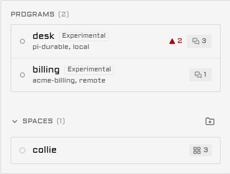
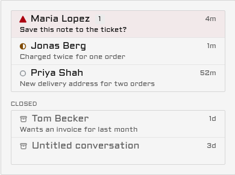
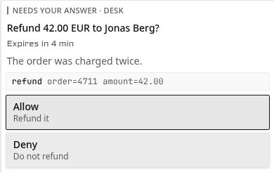
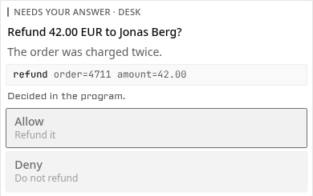
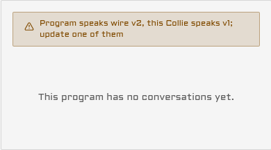

# Programs on the phone

> **Experimental.** What a program shows on the phone may change, or the feature may be removed, in
> a later minor release. [Programs](durable-programs.md#the-exit) says what decides whether it stays.

This page shows every place a program appears on your phone: its row on the dashboard, its list of
conversations, its questions, the chat, its starters and its pushes. [Programs](durable-programs.md)
attaches a program first.

A program draws a control only for what it said it can do in its hello. A row below that names a
control assumes the program declared it.

## The Programs section on the dashboard

Each program is one row in a Programs section, apart from your spaces.

| part of the row | what it shows |
| --- | --- |
| Line 1 | The program's name from `sources.json`, and an Experimental badge |
| Line 2 | Its runtime, the name the program gives itself in its hello, else `durable`. Then `local` or `remote` |
| Right edge, ready | The count of its open conversations, and in the needs-you colour the count that waits on you. The second count is hidden at zero |
| Right edge, not ready | The word Starting, Unreachable or Version mismatch, and no counts |

A program reached over its socket, or over `http://127.0.0.1` or `http://localhost`, is `local`.
Every other URL is `remote`.

The section sits below your spaces. It moves above them while any program has a conversation that
waits on you, and back below when the last one is answered. With no program attached, the section
is not drawn at all.

With "Show only panes that need you" on, the section lists only the programs that wait on you. Tap a
row in any state to open that program's conversation list.

## The conversation list

A program's home lists its conversations the way a messaging app lists its chats.

What waits on you comes first, then the other open conversations, newest first. The closed ones
follow under the label Closed. Each row shows the title, its state mark, the time of its last
activity, and one line under it: the question that waits, else the program's subtitle. A waiting row
also counts its open questions. A row with no title says "Untitled conversation".

Tap an open row to open it in Chat. Tap a closed row to read it, read-only. A closed conversation
has a Reopen button when the program can reopen one.

The open rows come from the dashboard's own data, so they draw at once. The closed ones come from the
program, which Collie asks once per visit and again when a conversation opens or closes, never on
every poll.

| at the foot of the list | when |
| --- | --- |
| Load more | The program has more than 100 conversations. Each tap reads the next 100 |
| "This program does not keep a list of its conversations." | The program answered that it keeps no list |
| "The program did not answer. Try again in a moment." | The program did not answer the read |
| "Program speaks wire v2, this Collie speaks v1. Update Collie, or the program's SDK." | Collie refused the program for its wire version ([Receipts](#receipts)) |
| "Couldn't load the conversations. Try again." | The read failed on the way |

A program that keeps no history shows its open conversations alone, with no Closed group and no
note. A list already drawn stays drawn when a later read fails.

## A question on the phone

A program's question is a card in the chat, under the tool call it is about.

The caption names the program, "Needs your answer · desk". When the program set an expiry, the line
under the title counts down: "Expires in 4 min", then "Expires in 40 s", then "Expired". Past the
expiry the buttons stay, and the program answers a late tap itself.

| kind | what the card shows | limits |
| --- | --- | --- |
| `permission` | One button per option, in Collie's words: Allow, Always allow, Deny or Cancel. The program's own label is the quiet second line | Up to 6 options |
| `choice` | One row per option. One tap sends the pick. With `multiple`, the rows toggle under "Pick any number" and Send sends the set | Up to 8 options |
| `text` | One line to type in, a count such as "12 of 500", and Send | 500 characters, or the program's limit up to 2000 |
| `form` | Its fields stacked under one Send: a text line, a choice as a list to pick from, or a toggle. A required field says Required | Up to 6 fields |

"Always allow" needs two taps. The first changes the button to "Tap again to always allow" and the
tool's name. The second sends it. Collie does not offer it when the question names no tool.

When Collie had to cut or clean the program's words, the card says "Text shortened" and offers no
"Always allow", because you were not shown the whole text.

A card of a kind this Collie does not know shows its words and says "This ask cannot be answered
from the phone." A conversation draws its first 5 questions as cards, and a "Show N more" row opens
the rest.

### What happens after a tap

Every tap carries one request id, and only a tap sends an answer.

| what happened | what the card says | what to do |
| --- | --- | --- |
| The program took the answer | Nothing: the card closes | Nothing |
| The program decided first | "Decided in the program." | Nothing. The chat keeps a line for it |
| The question timed out first | "Timed out before an answer." | Nothing. The chat keeps a line for it |
| Another answer came first | "Already answered. This card goes away on the next update." | Nothing |
| The question was not open, and the program did not say why | "Not taken. The question may show again in a moment." | Wait. A program that restarted asks again |
| The question changed under you | "This ask changed. Read it again, then tap an answer." | Read the new form and tap again |
| The answer may not have arrived | "Not sure the answer arrived. Try again sends it once more." | Tap Try again. It sends the same request id, so the program is told once |
| A retry found the question closed or changed | "May already be applied. Check the chat." | Check the chat |
| Collie refused the answer | Collie's reason, else "The answer was refused." | Read the reason |
| The program's machine runs an older Collie | "This machine runs an older Collie and cannot take answers here. Update it, or answer in the program." | Update that machine |

## Receipts

Collie tells you how a question ended when you did not answer it, and why a program is refused.

| case | what you see |
| --- | --- |
| The question has an expiry | The card shows the time left under its title |
| You tapped after the program decided, or after the expiry | The card freezes and says "Decided in the program." or "Timed out before an answer." |
| A question timed out, or the program decided it, with no tap from you | One line in the chat: "Timed out before an answer:" or "Decided in the program:", then the question's title |
| Collie refused the program for its wire version | A caution box on the program's home, and the words Version mismatch on its dashboard row |

A question you answered from the phone, or one that ended because you stopped the turn, leaves no
such line. Your tap already had its card.

The caution box says which wire version each side speaks, for example "Program speaks wire v2, this
Collie speaks v1. Update Collie, or the program's SDK." Update the older side. [Versions](durable-programs.md#versions)
has the rule.

## The chat

A program's conversation opens in Chat, its only view.

| item from the program | what Chat draws |
| --- | --- |
| `user` | Your own line |
| `reply` | The agent's answer |
| `thinking` | The agent's thinking |
| `notice` | A short note in the thread |
| `markdown` | Rendered markdown: headings, lists, emphasis, code and links. Raw HTML shows as text |
| `code` | A code block, with its language when the program named one |
| `link` | A link line with its label, else the address. Only `https://` links |
| `tool` | A tool call: running, done with its output, failed, or denied |

A `reply`, `thinking`, `notice` or `markdown` item that is still growing has a cursor at its end and
no time. The cursor goes when the final text arrives. A turn you stopped leaves the note "stopped".

### Your own line

Your line shows in the thread the moment you tap Send, with a small clock. When the program's own
copy arrives, it takes the line's place.

| state | what the line shows |
| --- | --- |
| Sending, or sent | The clock. The composer says "Sent" when the program took it |
| The answer never came | "Sending, not confirmed". Send again retries with the same request id |
| Refused, or the turn moved on | "Not sent", and your words go back into the field |

A program that does not echo the request id is matched by the same text within 30 seconds. A line
the program never writes back stops showing after 10 minutes.

While your line is the newest thing in the thread and the program has not answered, a row of three
dots says it is working.

### The header

The header is two lines. Line 1 is the conversation's title and the Experimental badge.

| line 2 shows | when |
| --- | --- |
| "Step 2 of 3: Save a note" | The program reports steps and one is running |
| "42%: uploading" | The program reports a percent, with its label |
| The program's subtitle | No progress, or every step is done |
| The workspace | The program sets none of these |

Progress shows only while the conversation works or waits on you.

### The belt

The belt holds Steer and Stop, then up to 4 buttons of the program's own.

Steer sends your text into the running turn instead of starting a new one. Stop ends the running
turn. A button that cannot act now is dimmed in place, so nothing moves.

| program button | the rule |
| --- | --- |
| Label | 16 characters at most |
| Icon | One of 12: `play`, `pause`, `check`, `x`, `refresh`, `archive`, `flag`, `star`, `send`, `note`, `search`, `more`. Any other name draws no icon |
| Busy | A spinner, and no tap |
| Disabled | Dimmed, and no tap |

A tap names the newest turn the phone saw. When the conversation has moved on, nothing runs and the
phone says so: "The conversation moved on, so the action did not run." Check it, then tap the button
again if you still want it.

### What a program pane does not have

A program has no screen, so its pane has no Terminal view, no tab or pane strips, and no Keys, Type
or Quick button. Its menu has no History, Pane settings or Pin to top row. Close in the menu reads
"Close conversation".

## New conversation and starters

The New page of a program is titled New conversation, and it lists the program's starters.

A starter takes no folder and no text: the program decides where it works. Tap one, and the program
opens a new conversation. The page offers no agent, shell or command of the machine. A program with
no starters says "This machine's program offers no starters yet."

## Push

A question can push to your phone, within caps for each program.

| cap | limit | past it |
| --- | --- | --- |
| One pane | 3 pushes a minute | The question shows on the phone and sends no push |
| One program on one machine | 10 pushes a minute | The same |
| One program on one machine | 30 pushes an hour | One push, "A program on {host} is raising many asks", then no push from that program for an hour |

The push says "Permission needed in" and the pane's name. A program may add its own title, at most
60 characters, and a line, at most 120. Collie pushes a question once per machine, program and tool
call, so a question asked again after a restart shows and does not push.
[Pushes from a program](voice-and-push.md#pushes-from-a-program) has the rest.

## Masking

With secret masking on (`COLLIE_REDACT`, on by default), Collie masks secrets in the titles and
subtitles of a program's conversation list.

## In a crew

The lead's dashboard has one Programs section for every machine of the crew. A member's program adds
the member's name to line 2, for example `pi-durable, local, workshop`, and the lead's own programs
name no machine. A question on any machine moves the one section above the spaces.
[Programs in a crew](crew.md#programs-in-a-crew) says who answers for what.
