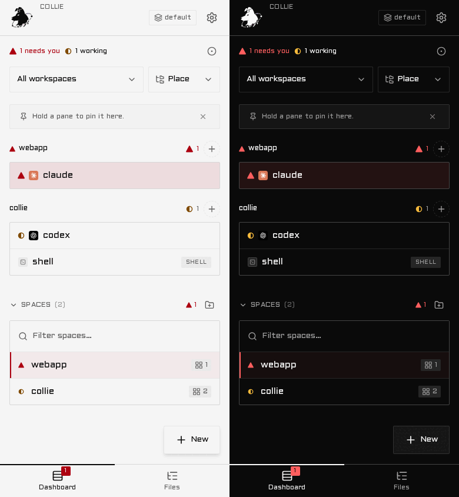
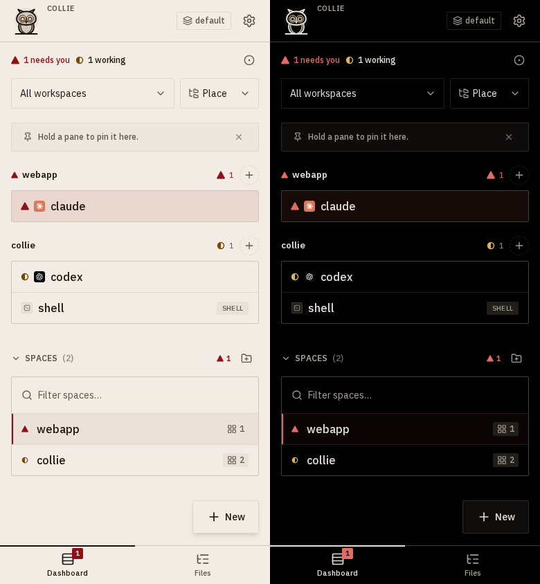
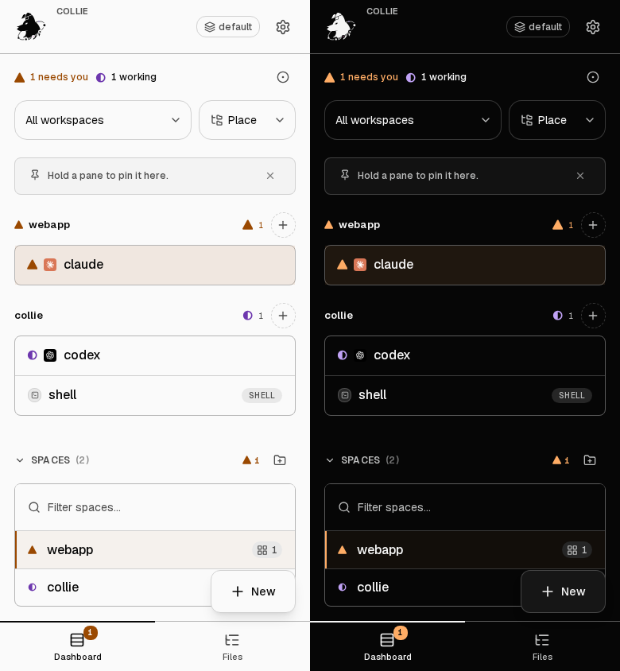
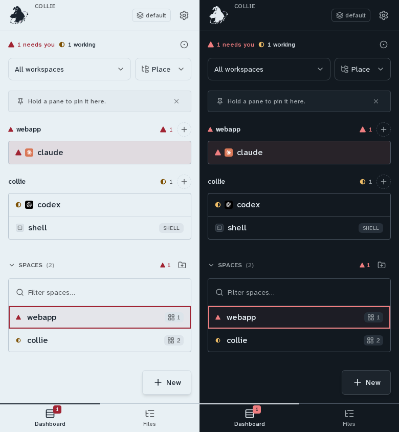

# Themes

A theme is the look of the app. It sets the colours, the typefaces, the shape of controls, the feel of the
page and the colours of the terminal. It is one small JSON file. Collie ships four. You can import more
from a file, and you can export any theme to copy and edit. A theme is a setting of one device, kept in
that browser, and it changes nothing on the bridge.

Every theme has two halves. The light half is the set of colours for light mode. The dark half is the set
for dark mode. A colour in a theme has a name, such as `background` or `primary`, and that name is a token.

## The four themes

Collie ships four themes, and three of them use every part of a theme file. Each picture shows the Dashboard,
light on the left and dark on the right.

- **Collie** is the look the app has always had. It is the default, and picking it takes every theme
  back off. It names no shape, no look and no palette, so every word of it is the default word of its list.

  

- **Nightwatch** is for the on-call phone in bed. The dark half is true black with one dim amber, and the
  light half is a warm dusk paper. It is square and flat, with heavy lines, bold text and a dim amber band
  behind the header and the bars. The terminal draws an amber palette on true black.

  

- **Daylight** is for direct sun and low vision. Body text is 7:1 or better, borders are stronger, and
  blocked is orange while done is blue, so the two stay apart without red and green. It has round corners,
  rows as lifted cards on a page that shifts toward the foot, darker in light and lighter in dark, and
  roomier steps. The terminal draws a vivid, high-contrast palette.

  

- **Harbour** is for people who live in a terminal. A cool blue-grey with one teal accent, in the key of
  Nord and Solarized, and code colours that read like an editor. It has soft corners, a fine grain under
  the page and thin icons. The terminal draws a Solarized-based palette.

  

The table lists every word each theme uses. The first word of each list is today's look: `sharp`, `default`,
`flat`, `page`, `rules` and `caps`. The words are explained under [Shape](#shape), [Look](#look)
and [Terminal palette](#terminal-palette).

| | Collie | Nightwatch | Daylight | Harbour |
| --- | --- | --- | --- | --- |
| Typeface | Aldrich | IBM Plex Sans | Geist | Atkinson Hyperlegible Next |
| Display face | the typeface | IBM Plex Sans | Atkinson Hyperlegible Next | Space Grotesk |
| Radius | `sharp` | `sharp` | `round` | `soft` |
| Shadow | `default` | `flat` | `lifted` | `lifted` |
| Density | `default` | `default` | `roomy` | `default` |
| Weight | `default` | `bold` | `default` | `default` |
| Border | `default` | `strong` | `default` | `default` |
| Ground | `flat` | `flat` | `gradient` | `grain` |
| Chrome | `page` | `band` | `page` | `page` |
| Rows | `rules` | `rules` | `cards` | `rules` |
| Icons | `default` | `heavy` | `default` | `thin` |
| Labels | `caps` | `caps` | `sentence` | `caps` |
| Terminal palette | the app's own | amber, on `#000000` | vivid, on `#1a1612` | Solarized-based, on `#0a1216` |

## Pick a theme

Pick a theme in **Settings → Appearance**, and the whole app changes at once.

The **Theme** card is the first card. Tap a name and the app changes at once. Each name wears its own
theme's corners and weight, so you see the shape before you tap. The card sits above the **Appearance**
card, which holds System, Light and Dark. These are two settings. The theme picks the colours, the shape and
the look, and System, Light or Dark picks which half of the colours you see.

A theme that names a typeface writes it into the **Typeface** card once, when you pick the theme. After
that the Typeface card wins: choose another face there and it stays, until you pick a theme again. The
display face of a theme is not part of that card: titles keep it. The
[typefaces](configure.md#your-own-typefaces) have their own section.

The faces these themes use ship Latin plus Latin Extended-A only, so Cyrillic and CJK text falls to the system
face under those themes (the Collie theme keeps its Cyrillic companion).

## Import a theme

Import a `.json` file in the **Theme** card, read the preview, and tap **Apply**.

1. In the **Theme** card, tap **Import** and choose a `.json` file.
2. Collie reads the file and shows a preview. It shows the name, the author, both halves as swatches, a
   small page for each half, the shape on a sample, the terminal colours, and a contrast report.
3. Tap **Apply** to keep the theme and switch to it, or **Cancel** to keep nothing.

A **warning** is a contrast report line, such as "dark: status-blocked chip on card measures 3.9. The floor is
4.5". It means the theme is hard to read in one place. **Apply** stays on, because the choice is yours.

A **refusal** means the file broke a rule. Collie lists the causes, keeps nothing, and applies nothing. The
list shows at most 25 causes, then one line "and N more". A file is refused for any of these:

- It is not a JSON object, or it is over 64 KiB.
- It sets no colour.
- It has an unknown key, a version Collie does not read, a value that is not a colour, or a typeface Collie
  does not ship.
- A shape word is not on its list, or a number stands where a word goes.
- It has a `surface` block, a `fonts.display` face or an `ansi` block, and says version 1.
- It sets `pane-active`, and says version 1 or 2.
- Its `ansi` block lacks a key, has a colour with an alpha, or fails a gate under
  [Terminal palette](#terminal-palette).
- It has a bad `id`, `name` or `author`, or the `id` belongs to a shipped theme.
- It would be a ninth imported theme. Collie refuses at the **Import** tap, before you pick a file, and again
  at **Apply**.

Collie checks one more thing at **Apply**. A file whose `id` is already on the device is refused with "already
imported". Remove the old theme first, or change the `id`.

A theme changes how the app looks and nothing else. It cannot run code, load files or reach a server.

A device holds up to eight imported themes. **Remove** works only while an imported theme is on. It deletes
that theme, and the app goes back to Collie. The typeface stays as it was.

## The contrast report

The report measures the colours of a theme in both halves, and a failed line is a warning that you can accept.

The terminal palette is the one exception, because its gates refuse the file. The table lists the floors of
the other parts. A floor is a contrast ratio, so a higher number is easier to read.

| Check | Floor |
| --- | --- |
| `foreground` and `muted-foreground` on `background` and on `card` | 4.5 |
| `primary-foreground` on `primary`, `destructive-foreground` on `destructive` | 4.5 |
| Each of the six status colours as a chip (the colour over its 15% wash), on `background` and on `card` | 4.5 |
| `status-blocked` as text, on `background` and on `card` | 4.5 |
| `destructive` as text, on `background` and on `card` | 4.5 |
| `destructive` as an icon, on `background` and on `card` | 3 |
| `rule` on `background` | 1.3 |
| `pane-active` on `background`, only in a half that sets it | 3 |
| `status-blocked` apart from `status-done` | a distance of 0.15 |

- **Destructive text is held to what Collie measures when you keep its colours.** Collie's own light red on
  its page measures 4.38. A theme that keeps both colours of the pair is held to that value and never below 3.
  A theme that moves either colour is held to 4.5.
- **A gradient or a grain is measured at its far end.** The report measures the page text, the chips,
  `destructive` text, `status-blocked` text and `rule` again on the foot of the gradient or on the grain's
  line colour, with the same floors.
- **A band is measured too.** Under `chrome: band`, `foreground`, `muted-foreground` and `status-blocked` are
  measured on `secondary`, the colour of the band, at 4.5.

## Export and share a theme

Pick the theme, then tap **Export**. Collie saves `<id>.collie-theme.json`. A browser that cannot save a
file shows the text in a sheet, with a copy button. To make your own theme from a shipped one:

1. Export Nightwatch, Daylight, Harbour or Collie.
2. Change `id` and `name`. An id of a shipped theme is refused.
3. Edit the colours and the words, and delete any token you do not want to change.
4. Send the file to your phone, then import it.

An export writes the lowest [version](#versions) that holds the content of the theme.

## Write a theme

A file has these keys, and no others. An unknown key anywhere is refused with its name. This is a complete
version 2 file: it is Daylight with a shorter list of colours and the full palette.

```json
{
  "version": 2,
  "id": "my-day",
  "name": "My day",
  "author": "Sam",
  "light": { "background": "oklch(0.985 0 0)", "primary": "oklch(0.18 0 0)" },
  "dark": { "background": "oklch(0.12 0 0)", "status-blocked": "oklch(0.81 0.13 60)" },
  "fonts": { "ui": "geist", "display": "atkinson" },
  "surface": {
    "radius": "round", "shadow": "lifted", "density": "roomy",
    "weight": "default", "border": "default", "ground": "gradient",
    "chrome": "page", "rows": "cards", "icons": "default", "labels": "sentence"
  },
  "ansi": {
    "0": "#3a332c", "1": "#ff5f56", "2": "#5fd068", "3": "#ffd84a",
    "4": "#5aa9ff", "5": "#e07ce8", "6": "#3fd6d0", "7": "#f2efe9",
    "8": "#8a827a", "9": "#ff8a80", "10": "#7ad683", "11": "#ffeb8a",
    "12": "#8cc4ff", "13": "#f0a6f5", "14": "#6ad8d2", "15": "#ffffff",
    "ink": "#f5f0e8", "ground": "#1a1612"
  }
}
```

- `version` is 1, 2 or 3. See [Versions](#versions). Any other number is refused.
- `id` is 1 to 32 characters: lower-case letters, digits and hyphens, starting with a letter or a digit.
- `name` is 1 to 40 characters, and `author` is up to 60. Neither may hold a control character.
- `light` and `dark` are objects of tokens. Give one half or both. A half you leave out, and any token you
  leave out, takes the value of the theme Collie. If only one half sets a token, the other half gets the value
  of the theme Collie for that token.
- `fonts.ui` is optional: `system`, `grotesk`, `aldrich`, `plex`, `geist` or `atkinson`.
- `fonts.display` is optional and takes the same six names. See [Look](#look).
- `surface` is optional. Every key in it is optional too, and a key you leave out takes the default word of its list.
  See [Shape](#shape) and [Look](#look).
- `ansi` is optional, and it holds all 18 keys or none. See [Terminal palette](#terminal-palette).
- `$schema` is allowed and ignored. The file is at most 64 KiB.

A value is `#rrggbb`, `#rrggbbaa`, or `oklch(L C H)` and `oklch(L C H / A)` in plain numbers. L is 0 to 1, C is
0 to 0.5, H is 0 to 360, and A is 0 to 1 or a percentage. Nothing else works: no named colour, no `rgb()`, no
`var()`, no `url()`. A colour in `ansi` has no alpha.

### Versions

A file says which version it is, and Collie writes the lowest version that holds what the file has.

| Version | What the file may hold |
| --- | --- |
| 1 | Colours in `light` and `dark`, and `fonts.ui`. |
| 2 | Everything in version 1, and any of `surface`, `fonts.display` and `ansi`. |
| 3 | Everything in version 2, and the optional token `pane-active`. |

- A file with a `surface` block, a `fonts.display` face or an `ansi` block must say 2. A file that says 1 and
  has one of them is refused.
- A file with `pane-active` in `light` or `dark` must say 3. A file that says 1 or 2 and sets it is
  refused. The cause names the token and the version.
- A file without those blocks and without `pane-active` may say 1 or 2. Collie reads all three versions,
  and an export of a theme with colours and `fonts.ui` only says 1.
- A version 2 file needs Collie 1.22.0 or newer.
- A version 3 file needs Collie 1.24.0 or newer. An older Collie refuses it and names the version: "The
  file is version 3. This Collie reads version 1 and 2." A theme that does not set `pane-active` keeps
  its version, so an older Collie still reads it.
- A version 1 file means the default word of each list for every token of `surface`.

### The 43 tokens

Each half takes any of these, in four groups.

| Token | Meaning |
| --- | --- |
| **Surfaces and inks** | |
| `background` `card` `chrome` | The page, a raised panel, and the header and bars. |
| `foreground` `card-foreground` | Text on the page, and text on a card. |
| `primary` `primary-foreground` | The main button, and the text on it. |
| `secondary` `secondary-foreground` | A quieter button, and its text. Also the fill of the band under `chrome: band`. |
| `muted` `muted-foreground` | A quiet surface, and the grey text. |
| `accent` `accent-foreground` | A hover or a selected row, and its text. |
| `control-on` `control-on-foreground` | A switch or a segment that is on, and its text. |
| `destructive` `destructive-foreground` | The delete button, and its text. |
| `border` `input` `rule` `ring` | The edge of a box, the edge of a field, a thin line between rows, the focus ring. |
| **Status** | |
| `status-blocked` | An agent waits on you. |
| `status-working` | An agent is working. |
| `status-done` | An agent is done. |
| `status-idle` | An agent is at rest. |
| `status-unknown` | Collie cannot tell. |
| `status-info` | A note, not a state. |
| **Syntax** | |
| `syntax-keyword` `syntax-string` `syntax-constant` | Keywords, strings, and numbers or constants in code and diffs. |
| `syntax-property` `syntax-entity` `syntax-comment` | Property names, types and function names, and comments. |
| **Host** | |
| `host-0` `host-1` `host-2` `host-3` `host-4` `host-5` `host-6` `host-7` `host-8` `host-9` | The ten colours that tell your machines apart. |

### The optional token

One more token is optional, and it is the reason for version 3. It is not one of the 43, and a theme may
leave it out.

| Token | Meaning |
| --- | --- |
| `pane-active` | The frame of the active pane column on a large screen. |

When a theme leaves out `pane-active` in a half, that half takes the sky blue of the theme Collie. Collie
measures it only in a half that sets it. See [The contrast report](#the-contrast-report). A file that sets it
must say [version 3](#versions).

## Shape

Five words in the `surface` block set the shape of controls, and each key takes one word from a closed list.

A word is a name, never a number. A free radius or a free spacing step could break the tap floor or make a
square control a stadium. The first word of each list is the look the app had before version 2.

| Key | Word | What it does |
| --- | --- | --- |
| `radius` | `sharp` | Corners of 2px at every step. The default. |
| | `soft` | Corners of 4, 6, 8 and 12px at the four steps. |
| | `round` | Corners of 8, 12, 16 and 24px at the four steps. |
| `shadow` | `default` | The shadows the app has always drawn. |
| | `flat` | No shadow anywhere. |
| | `lifted` | Every shadow one step deeper. |
| `density` | `default` | Spacing as it is. |
| | `roomy` | Every space, gap, height and width 12% larger. |
| `weight` | `default` | Medium text at 500 and semibold text at 600. |
| | `bold` | Medium text at 600 and semibold text at 700. |
| `border` | `default` | Lines of 1px. |
| | `strong` | Lines of 2px. |

- **Circles stay circles.** A shape whose width equals its height, such as a status dot, is not a corner
  step, so `radius` does not move it.
- **A marked row follows the radius.** Under `sharp`, a selected or blocked row wears a 2px bar on its left
  edge. Under `soft` and `round` it wears a 2px ring on all four sides and a soft shadow, because a left bar
  never pairs with rounded corners.
- **`roomy` never goes below the default.** Tap targets stay at 44px or larger. The icons and the dog in the
  header keep their size, so only the space around them grows.

## Look

Five more keys of the `surface` block and one font key set the look of the page. They follow the same rule
of closed words.

| Key | Word | What it does |
| --- | --- | --- |
| `ground` | `flat` | The page is one colour. The default. |
| | `gradient` | The page runs from `background` at the top to `background` mixed with 12% of `primary` at the foot. |
| | `grain` | Two sets of fine diagonal lines of `background` mixed with 4% of `foreground`. |
| `chrome` | `page` | The header, the tab bar and the bottom bar are the page colour with a rule. The default. |
| | `band` | They are filled with `secondary` and edged with `border`. |
| `rows` | `rules` | A list is one framed group with a line between rows. The default. |
| | `cards` | Every row is its own card: a gap, an edge, a corner, a small shadow and the `card` colour. |
| `icons` | `default` | Icon lines of 2. |
| | `thin` | Icon lines of 1.5. |
| | `heavy` | Icon lines of 2.5. |
| `labels` | `caps` | Small section labels in capitals with a little spacing. The default. |
| | `sentence` | The same labels as they are typed. |

`fonts.display` names one of the six typefaces for page titles and the name in the header. A theme that
names none draws its titles in the typeface, as before. Collie fetches a display face only when the theme
names it.

- **A ground draws no image file.** The gradient and the grain are built from the colours of the theme itself.
  The panels of the app are opaque, so the ground shows in the gaps between them.
- **The page text is measured on the ground.** The [contrast report](#the-contrast-report) checks the far end
  of a gradient and the grain's line colour, so a ground cannot hide text.
- **Under a gradient the bars keep the flat page colour.** On a tablet the header and the bars can read as
  a box at the top of a page that darkens below. A word cannot change that.
- **The status bar follows a band.** Under `chrome: band` the browser's status bar takes the band colour, and
  under `page` it takes the page colour.
- **`rows` reaches every list group.** That includes the list inside the Settings index.

## Terminal palette

The `ansi` block gives the terminal mirror its own 16 colours, its ink and its ground.

The block holds all 18 keys or none: `"0"` to `"15"` for the 16 slots, `ink` for the text and `ground` for the
background. A half palette would put two palettes in one pane. Each colour is `#rrggbb` or `oklch()`, with
no alpha.

> **Note.** Write the palette for dark. The mirror always draws on a dark ground, and in light mode Collie
> turns the whole mirror over instead of recolouring it
> ([why](configure.md#the-terminal-mirror-is-deliberately-different)). Light shows the mirror image of your
> colours. Pick a `ground` that turns into the light `background` of your theme, and the mirror joins the
> page in both modes.

A colour that fails a gate is refused with its key named. It is not a warning, because the terminal is what you
read most.

| Gate | Rule |
| --- | --- |
| Ink | `ink` on `ground` at 4.5 or better. |
| Dark space | `ground` is darker than `ink`. |
| Slots | Slots 1 to 15 on `ground` at 3 or better. Slot 0 is exempt, because black draws as no colour. |
| Bright set | Slots 3, 7, 11 and 15 have a relative luminance above 0.6. |
| The rest | The other 12 slots have a relative luminance of 0.6 or less. |

The bright set is a fixed list: the Muse mirror treats those four slots as the bright foregrounds. The
other 12 slots stay under the same line, so that list stays true under your palette.

## What a theme cannot change

A theme changes the value of a colour, its typefaces, the shape of controls, the feel of the page and the
palette of the terminal. It cannot change anything else.

- **Layout and tap sizes.** A phone layout is easy to break. Radius, shadow, density, weight and border are
  closed words, never free values, and `roomy` never goes below the default.
- **Type sizes and motion.** A theme picks a typeface and a weight, not a size, and it cannot change how
  anything moves.
- **The Collie dog.** The header, the home-screen icon and the splash look the same under every theme.
- **What a status means.** Its icon and its word stay as they are, so a red or orange you picked never
  makes blocked look like done.
- **A free value, raw CSS, remote fonts.** Every key takes a colour or a word from a list, and fonts come from
  the list Collie ships.

## The first paint and the status bar

Your pick is on screen from the first frame. A small script reads it before the app loads, so a shipped theme
does not flash the default first. An imported theme does the same, with one exception. If a token is set in
only one half, that token shows the default colour for one frame. The app checks the theme again when it
loads. A stored theme that fails the check is dropped, the device shows Collie, and the browser console says why. The status bar
follows the theme's two page colours, or its two band colours when the theme says `chrome: band`.

## Troubleshooting

These are the problems people meet most, with the cause and the fix for each.

- **A theme shows the default colour on one token.** The file left that token out, or the half. Missing
  tokens come from the theme Collie. Add the token to the half you want.
- **The face did not change.** A theme writes its face once, when you pick it. If you chose another face in
  **Typeface** afterwards, that choice wins. Pick the face again, or pick the theme again.
- **A shape word does nothing.** The word may be the default word of its list, or the key may be missing.
  A key you leave out takes the default word. Check the spelling against the tables under [Shape](#shape)
  and [Look](#look).
- **The file is refused and names `ansi`.** A palette holds all 18 keys, in dark space, and each colour
  must pass its gate. The refusal names the key and the number it measured.
- **The theme is gone after clearing browser data.** Imported themes live in this browser only. Import the
  file again.
