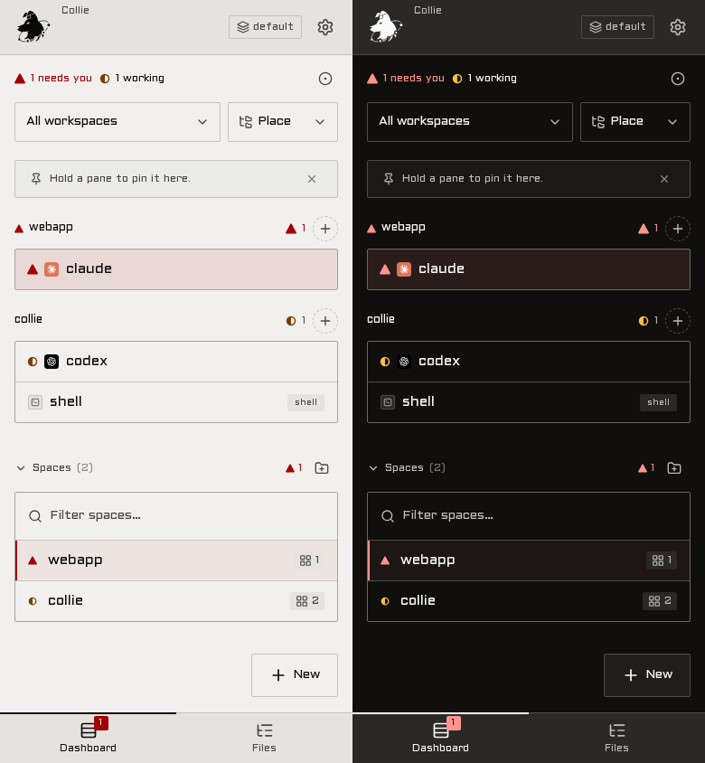
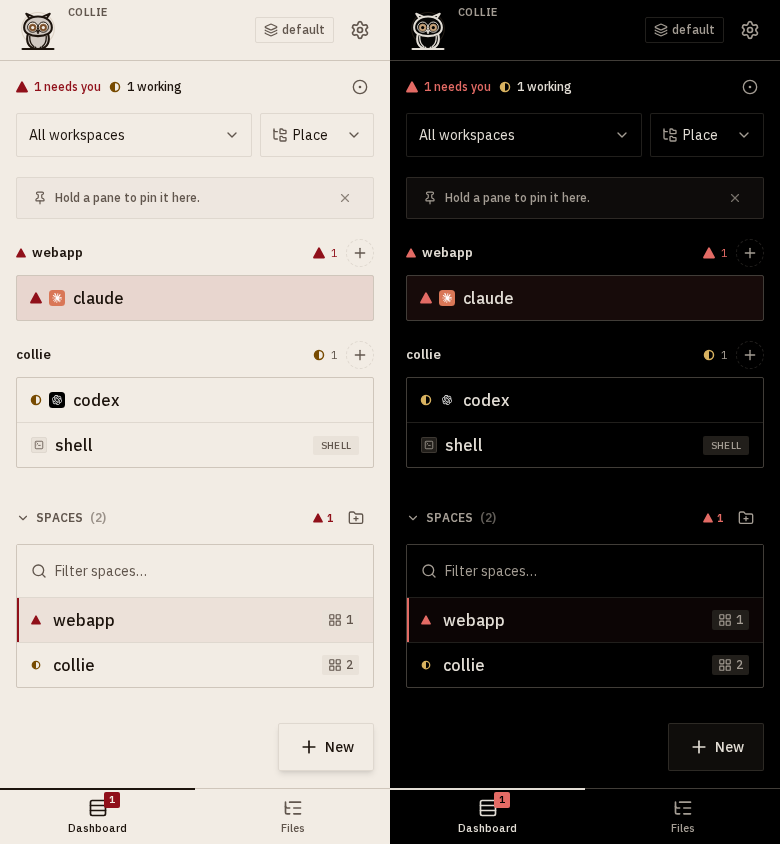
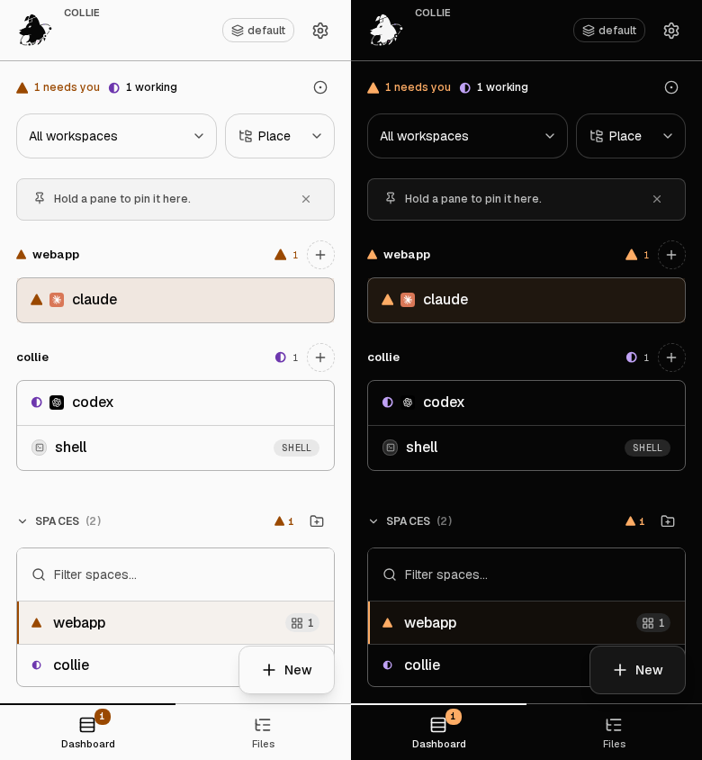
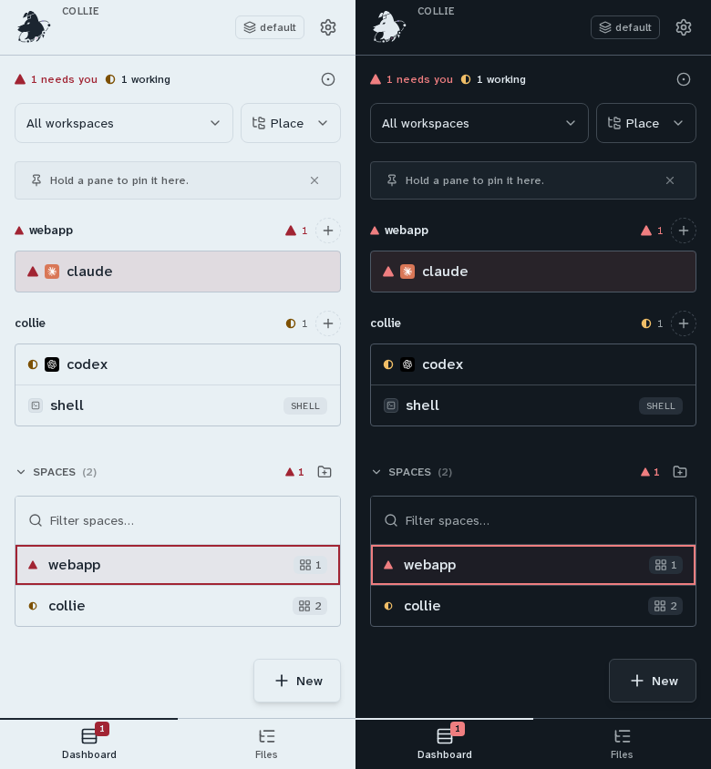

# Themes

## How sharing works

A theme is a small file of colours and words. Anyone can share one, and none can run code.

**What a theme can name.** Colours for the light half and for the dark half, typefaces from Collie's
list, words for the [shape](#shape) and the [look](#look), a [ground pattern](#ground-patterns)
behind the page, a [terminal palette](#terminal-palette) and a [character](#characters) for the
header. [Write a theme](#write-a-theme) shows the file.

**What a theme can never do.** It cannot run code. It cannot load a file, a font or an image. Every
key takes a checked colour or a word from a closed list, and Collie refuses any other file.
[What a theme cannot change](#what-a-theme-cannot-change) lists the limits.

**How a theme gets into the store.** The maker puts the file in a public GitHub repository with the
topic `colliepwa-theme`. The file is `collie-theme.json` at the root, or
`themes/<id>.collie-theme.json`. Once a day, colliepwa.dev checks each file with the app's own
check, and a review reads the repository's words.

A theme that passes both is listed, with the repository's star count from GitHub. The steps are in
[Share a theme on colliepwa.dev](#share-a-theme-on-colliepwadev).

**How you get one.** Every way in starts in the **Theme** card in **Settings → Appearance**.

- **Browse community themes** lists the store. Your host fetches the list, and your phone checks
  each theme again. See [Browse community themes](#browse-community-themes).
- **Try** wears a theme without keeping it. See [Try a theme](#try-a-theme-before-you-keep-it).
- **Install** opens a preview, and **Apply** keeps the theme.
- **Import** takes a file and **Paste** takes its text. See [Import a theme](#import-a-theme).
- **About** shows where a kept theme came from. **Check for updates** and **Update** bring its
  newest listed version. See [About and Update](#see-where-a-theme-came-from-and-update-it).

**Let your coding agent write one.** Tell it to run `collie theme skill`, which prints the loop and
the file format, and then `collie theme check` on its file until the check is clean. See
[Let your coding agent write it](#let-your-coding-agent-write-it).

**The way back.** Add `#theme=collie` to the app's address, and Collie's own theme comes back,
whatever a theme did. See [Troubleshooting](#troubleshooting).

## Make Collie your own

Two choices in **Settings → Appearance** make the app look like yours, and both stay on this device.

- **Theme** picks the colours, the typefaces and the shape. Pick one of four, or add one and try it before
  you keep it. See [Pick a theme](#pick-a-theme).
- **Appearance** picks System, Light or Dark, which is the half of the theme you see.

A theme you write can go further and put its own [character](#characters) in the header.

A theme is the look of the app. It sets the colours, the typefaces, the shape of controls, the feel of the
page and the colours of the terminal. It is one small JSON file. Collie ships four. You can import more
from a file, and you can export any theme to copy and edit. A theme is a setting of one device, kept in
that browser, and it changes nothing on the bridge.

Every theme has two halves. The light half is the set of colours for light mode. The dark half is the set
for dark mode. A colour in a theme has a name, such as `background` or `primary`, and that name is a token.

## The four themes

Collie ships four themes, and every one of them uses every part of a theme file except [`character`](#characters). Each picture shows the Dashboard,
light on the left and dark on the right.

- **Collie** is the default. It is black and white like the Collie dog, with warm neutral greys, the black ink
  of the open tab and the open pane, square corners, thin lines, flat edges and bold labels. The text is
  stronger and the lines are firmer than in a plain grey look, and a grey band stands behind the header and
  the bars. A faint crossed grain (the `ground` word `grain`) is drawn behind the page. The open tab is a folder tab, and the composer opens like a chat box. The terminal draws a
  high-contrast palette. Picking it takes every other theme back off.

  

- **Nightwatch** is for the on-call phone in bed. The dark half is true black with one dim amber, and the
  light half is a warm dusk paper. It is square and flat, with heavy lines, bold text and a dim amber band
  behind the header and the bars. The terminal draws an amber palette on true black.

  

- **Daylight** is for direct sun and low vision. Body text is 7:1 or better, borders are stronger, and
  blocked is orange while done is blue, so the two stay apart without red and green. It has round corners,
  rows as lifted cards on a page that shifts toward the foot, darker in light and lighter in dark, and
  roomier steps. The terminal draws a vivid, high-contrast palette.

  

- **Harbour** is for people who live in a terminal. A cool blue-grey with one teal accent, in the key of
  Nord and Solarized, and code colours that read like an editor. It has soft corners, a fine grain under
  the page and thin icons. The terminal draws a Solarized-based palette.

  

The table lists every word each theme uses. The first word of each list is the word a theme gets when its file
names none: `sharp`, `flat`, `default`, `bold`, `default`, `flat`, `band`, `rules`, `default`, `sentence`,
`screen`, `plain` and `field`. That is what the Collie theme draws, except for `ground`, `tabs` and `composer`,
which the Collie theme sets to `grain`, `folder` and `box`. The words are explained under [Shape](#shape), [Look](#look) and
[Terminal palette](#terminal-palette).

| | Collie | Nightwatch | Daylight | Harbour |
| --- | --- | --- | --- | --- |
| Typeface | Atkinson Hyperlegible Next | IBM Plex Sans | Geist | Atkinson Hyperlegible Next |
| Display face | Aldrich | IBM Plex Sans | Atkinson Hyperlegible Next | Space Grotesk |
| Radius | `sharp` | `sharp` | `round` | `soft` |
| Shadow | `flat` | `flat` | `lifted` | `lifted` |
| Density | `default` | `default` | `roomy` | `default` |
| Weight | `bold` | `bold` | `default` | `default` |
| Border | `default` | `strong` | `default` | `default` |
| Ground | `grain` | `flat` | `gradient` | `grain` |
| Chrome | `band` | `band` | `page` | `page` |
| Rows | `rules` | `rules` | `cards` | `rules` |
| Icons | `default` | `heavy` | `default` | `thin` |
| Labels | `sentence` | `caps` | `sentence` | `caps` |
| Tabs | `folder` | `plain` | `plain` | `plain` |
| Composer | `box` | `field` | `field` | `field` |
| Tab colour | the text colour | the text colour | the text colour | the text colour |
| Terminal palette | high contrast, on `#100f0d` | amber, on `#000000` | vivid, on `#1a1612` | Solarized-based, on `#0a1216` |

## Pick a theme

Pick a theme in **Settings → Appearance**, and the whole app changes at once.

The **Theme** card is the first card. Tap a name and the app changes at once. Each name wears its own
theme's corners and weight, so you see the shape before you tap. The card sits above the **Appearance**
card, which holds System, Light and Dark. These are two settings. The theme picks the colours, the shape and
the look, and System, Light or Dark picks which half of the colours you see.

A theme that names a typeface writes it into the **Typeface** card once, when you pick the theme. After
that the Typeface card wins: choose another face there and it stays, until you pick a theme again. The
display face of a theme is not part of that card: titles keep it. A phone that never chose a theme or a
typeface draws Atkinson Hyperlegible Next, the same face the Collie theme names. Aldrich stays a choice on the
Typeface card. The [typefaces](configure.md#your-own-typefaces) have their own section.

The faces these themes use ship Latin plus Latin Extended-A only, so Cyrillic and CJK text falls to the system
face under those themes (Aldrich keeps its Cyrillic companion).

## Import a theme

Import a `.json` file in the **Theme** card, read the preview, and tap **Apply**.

1. In the **Theme** card, tap **Import** and choose a `.json` file.
2. Collie reads the file and shows a preview. It shows the name, the author, both halves as swatches, a
   small page for each half, the shape on a sample, the terminal colours, and a contrast report.
3. Tap **Apply** to keep the theme and switch to it, or **Cancel** to keep nothing.

To import the text of a theme file instead of a file, tap **Paste**, paste the text, and tap **Read**.
Collie shows the same preview, and it refuses the same files for the same causes. Collie does not
fetch a theme from a link. Open the link, copy the text of the file, and paste that.

### Browse community themes

Tap **Browse community themes** in the **Theme** card, then **Install** on a theme you like.

The sheet lists the themes people share on GitHub with the topic `colliepwa-theme` (see
[Share a theme on colliepwa.dev](#share-a-theme-on-colliepwadev)). Each row draws the theme small, in
light and in dark, with its name, its author and a link to its repository. Under the name, `@owner`
names the GitHub account that holds the repository, and `★ 12` is its star count. The owner always comes
from the repository's own address, so a listing cannot claim another name. **Install** opens the same
preview as **Import**, and **Apply** keeps the theme.

The list comes from your host, not from the internet. **Refresh** asks the host to fetch it once from
colliepwa.dev, and nothing else fetches it: not a timer, not opening Settings. The line above the list
says how old the host's copy is. A refresh needs a device that may write. A refresh within a minute
of the last good one shows the same copy, and a copy older than a week is not shown.

Every theme is checked three times: by the site, by your host and by your phone. A theme that fails
any check is left out, and the sheet counts how many were. A theme whose file says a version newer
than your Collie reads is listed anyway, as a muted row that says "Needs a newer Collie". It has its
repository link and **Report**, and no **Install** or **Try**. **Report** opens a new issue on the collie
repository with the theme's repository filled in. You read it and send it yourself.

### See where a theme came from, and update it

Pick the theme in the **Theme** card, then tap the **i** button beside it.

The **About this theme** sheet shows the name, the author and where the theme came from. A theme from
**Browse community themes** shows its repository as `@owner/name`, the file, the short commit and the
date you installed it. The file link opens that file on GitHub at that commit. **Report** is there too.

A theme from a file says "Added from a file", and a pasted one says "Pasted", each with the date. A
theme you kept before this version says "Added on this device". Shipped themes have no About sheet.

For a theme from the list, the sheet compares it with your host's copy of the list:

| The sheet says | It means |
| --- | --- |
| A newer version is listed. | The list holds another commit of the same file. Tap **Update**. |
| No newer version is listed. | You have the commit the list holds. |
| No longer listed. | The list no longer holds the file. Your copy stays. |
| The listed version needs a newer Collie. | The list holds the file at a version this Collie cannot read. Update Collie to get it. Your copy keeps working. |
| **Check for updates** | Your host has no copy of the list yet. The tap fetches the list once. |

**Update** opens the same preview as **Install**, with the same contrast report. Tap **Update** there
to put the new file in place of the old one. The theme stays on if you wore it, and the eight-theme
limit does not stop an update.

Collie matches the repository and the file, never the theme's id. A theme copied from another
repository with the same id is never offered as an update. The repository matches in any case, as
on GitHub.

Any other commit of the file counts as newer, because the list holds the commit the site saw last.
Collie compares no clocks. To be sure the host's copy is fresh, tap **Refresh** in **Browse community
themes** first.

### Try a theme before you keep it

Tap **Try** in the preview or on a row of **Browse community themes**, and the whole app wears the
theme. A ribbon at the bottom edge says "Trying" and the theme's name. Tap **Keep** to keep it, the
same as **Apply**, or **Back** to go back to your own theme.

A trial keeps nothing. It stays on through a reload of the same tab, and a new tab or a new start of
the app shows your own theme. A **Keep** that Collie refuses, for example a ninth imported theme,
shows the reason in the ribbon, and the trial goes on. A pick in the **Theme** card ends the trial.

The ribbon keeps its own colours and its own typeface whatever the theme sets, so **Back** is always
there to tap. While it shows, the app ends above it and nothing hides under it.

A **warning** is a contrast report line, such as "dark: status-blocked chip on card measures 3.9. The floor is
4.5". It means the theme is hard to read in one place. **Apply** stays on, because the choice is yours.

A **refusal** means the file broke a rule. Collie lists the causes, keeps nothing, and applies nothing. The
list shows at most 25 causes, then one line "and N more". A file is refused for any of these:

- It is not a JSON object, or it is over 64 KiB.
- It sets no colour.
- It has an unknown key, a version Collie does not read, a value that is not a colour, or a typeface Collie
  does not ship.
- A shape word is not on its list, or a number stands where a word goes.
- It has a `surface` block, a `fonts.display` face or an `ansi` block, and says version 1.
- It sets `pane-active`, and says version 1 or 2.
- It sets `character`, and says version 1, 2 or 3. Or `character` is not a word from
  [Characters](#characters).
- Its `ansi` block lacks a key, has a colour with an alpha, or fails a gate under
  [Terminal palette](#terminal-palette).
- It has a bad `id`, `name` or `author`, or the `id` belongs to a shipped theme.
- Its body text cannot be read: `foreground` on `background` measures under 3 in a half, or a text colour
  (`foreground` or a `*-foreground` token) is fully transparent. A token the file leaves out is measured
  with Collie's value, the one the app fills it with.
- It would be a ninth imported theme. Collie refuses at the **Import** or **Paste** tap, before you pick a
  file, and again at **Apply**.

Collie checks one more thing at **Apply**. A file whose `id` is already on the device is refused with "already
imported". Remove the old theme first, or change the `id`.

A theme changes how the app looks and nothing else. It cannot run code, load files or reach a server.

A device holds up to eight imported themes. **Remove** works only while an imported theme is on. It deletes
that theme, and the app goes back to Collie. The typeface stays as it was.

## The contrast report

The report measures the colours of a theme in both halves, and a failed line is a warning that you can accept.

Two checks refuse the file instead: the terminal palette's gates, and `foreground` on `background` under 3 in
a half (the list above). The table lists the floors of
the other parts. A floor is a contrast ratio, so a higher number is easier to read.

| Check | Floor |
| --- | --- |
| `foreground` and `muted-foreground` on `background` and on `card` | 4.5 |
| `primary-foreground` on `primary`, `destructive-foreground` on `destructive` | 4.5 |
| Each of the six status colours as a chip (the colour over its 15% wash), on `background` and on `card` | 4.5 |
| `status-blocked` as text, on `background` and on `card` | 4.5 |
| `destructive` as text, on `background` and on `card` | 4.5 |
| `destructive` as an icon, on `background` and on `card` | 3 |
| `rule` on `background` | 1.3 |
| `pane-active` on `background`, only in a half that sets it | 3 |
| `tab-active` on `background`, only in a half that sets it | 3 |
| `status-blocked` apart from `status-done` | a distance of 0.15 |

- **Destructive text is held to what Collie measures when you keep its colours.** A theme that keeps both
  colours of the pair as the Collie theme has them is held to what that pair measures, and never below 3.
  A theme that moves either colour is held to 4.5.
- **A ground is measured on the colour it draws.** The report measures the page text, the chips,
  `destructive` text, `status-blocked` text and `rule` again on the foot of a gradient, or on the colour of
  a pattern's lines, dots or shapes, with the same floors.
- **A band is measured too.** Under `chrome: band`, `foreground`, `muted-foreground` and `status-blocked` are
  measured on `secondary`, the colour of the band, at 4.5.

## Export and share a theme

Pick the theme, then tap **Export**. Collie saves `<id>.collie-theme.json`. A browser that cannot save a
file shows the text in a sheet, with a copy button. To make your own theme from a shipped one:

1. Export Nightwatch, Daylight, Harbour or Collie.
2. Change `id` and `name`. An id of a shipped theme is refused.
3. Edit the colours and the words, and delete any token you do not want to change.
4. Send the file to your phone, then import it.

An export writes the lowest [version](#versions) that holds the content of the theme.

To have an AI agent write a theme for you, see
[Let your coding agent write it](#let-your-coding-agent-write-it).

## Share a theme on colliepwa.dev

Put the file in a public GitHub repository with the topic `colliepwa-theme`, and colliepwa.dev/themes
lists it.

1. Export the theme, as under [Export and share a theme](#export-and-share-a-theme).
2. Put the file at the root of a public GitHub repository, named `collie-theme.json`.
3. Add the topic `colliepwa-theme` to the repository, in the **About** box of its GitHub page.

One repository can hold several themes. Put each one under `themes/` with its id in the name, for
example `themes/my-day.collie-theme.json`, and leave out `collie-theme.json` at the root, or keep it as
one more theme. The `author` field of a file is the credit the site shows.

```text
my-themes/
  README.md
  themes/
    my-day.collie-theme.json
    my-night.collie-theme.json
```

### Check a theme before you share it

```sh
collie theme check collie-theme.json
```

The verb runs the check the app runs at **Import**, on a file on your computer. It prints one line per
refusal and one per contrast warning, in the words Settings shows. Name several files to check them
all, for example `collie theme check themes/*.collie-theme.json`.

| Exit code | Meaning |
| --- | --- |
| 0 | Every file passes. A contrast warning does not fail it. |
| 1 | A file is refused, or cannot be read. |
| 2 | A usage error, such as no file named. |

`--json` prints the report as one JSON object, for a CI job. `--shipped` accepts the id of a shipped
theme, for Collie's own files. The verb reads only the files you name, and it needs no running Collie.

### What the site does with it

Once a day, the site looks for repositories with the topic. It reads every theme file with the same
check the app runs at **Import**, and a model reads the name, the description and the README of the
repository. A repository that passes is listed within a day. The site checks a listed repository
again when its default branch has a new commit.

The Theme card lists every listed theme under **Browse community themes**, after a **Refresh** on
your host. The site shows each theme as a card: the name, the author, the repository, both halves drawn from the
file's colours, and a link to the raw file. To use a theme from the site, download the file and
[import it](#import-a-theme), or copy the text of the file and paste it under **Paste**. A theme is data, and like any import [it cannot run
code](#import-a-theme).

The site refuses a repository for any of these:

- A theme file that Collie refuses, for any cause under [Import a theme](#import-a-theme).
- No theme file at the root or under `themes/`.
- A repository that is not about Collie themes.
- Abuse: words or content that do not belong on a public list, or text that tries to give the
  model orders.

A refused repository stays off the list until someone asks for a new check. Ask in an
[issue on the collie repository](https://github.com/AltanS/collie/issues), with the name of the
repository.

## Write a theme

A file has these keys, and no others. An unknown key anywhere is refused with its name. This is a complete
version 2 file: it is Daylight with a shorter list of colours and the full palette. A theme that sets
[`character`](#characters) or [`glyphs`](#glyphs) says version 4.

```json
{
  "version": 2,
  "id": "my-day",
  "name": "My day",
  "author": "Sam",
  "light": { "background": "oklch(0.985 0 0)", "primary": "oklch(0.18 0 0)" },
  "dark": { "background": "oklch(0.12 0 0)", "status-blocked": "oklch(0.81 0.13 60)" },
  "fonts": { "ui": "geist", "display": "atkinson" },
  "surface": {
    "radius": "round", "shadow": "lifted", "density": "roomy",
    "weight": "default", "border": "default", "ground": "gradient",
    "chrome": "page", "rows": "cards", "icons": "default", "labels": "sentence"
  },
  "ansi": {
    "0": "#3a332c", "1": "#ff5f56", "2": "#5fd068", "3": "#ffd84a",
    "4": "#5aa9ff", "5": "#e07ce8", "6": "#3fd6d0", "7": "#f2efe9",
    "8": "#8a827a", "9": "#ff8a80", "10": "#7ad683", "11": "#ffeb8a",
    "12": "#8cc4ff", "13": "#f0a6f5", "14": "#6ad8d2", "15": "#ffffff",
    "ink": "#f5f0e8", "ground": "#1a1612"
  }
}
```

- `version` is 1, 2, 3 or 4. See [Versions](#versions). Any other number is refused.
- `id` is 1 to 32 characters: lower-case letters, digits and hyphens, starting with a letter or a digit.
- `name` is 1 to 40 characters, and `author` is up to 60. Neither may hold a control character.
- `light` and `dark` are objects of tokens. Give one half or both. A half you leave out, and any token you
  leave out, takes the value of the theme Collie. If only one half sets a token, the other half gets the value
  of the theme Collie for that token.
- `fonts.ui` is optional: `system`, `grotesk`, `aldrich`, `plex`, `geist`, `atkinson` or `nunito`.
- `fonts.display` is optional and takes the same seven names. See [Look](#look).
- `surface` is optional. Every key in it is optional too, and a key you leave out takes the default word of its list.
  See [Shape](#shape) and [Look](#look).
- `ansi` is optional, and it holds all 18 keys or none. See [Terminal palette](#terminal-palette).
- `character` is optional, one word from [Characters](#characters). It needs version 4.
  See [Characters](#characters).
- `glyphs` is optional, one word from [Glyphs](#glyphs). It needs version 4. See [Glyphs](#glyphs).
- `$schema` is allowed and ignored. The file is at most 64 KiB.

A value is `#rrggbb`, `#rrggbbaa`, or `oklch(L C H)` and `oklch(L C H / A)` in plain numbers. L is 0 to 1, C is
0 to 0.5, H is 0 to 360, and A is 0 to 1 or a percentage. Nothing else works: no named colour, no `rgb()`, no
`var()`, no `url()`. A colour in `ansi` has no alpha.

### Let your coding agent write it

```sh
collie theme skill
collie theme check my-day.collie-theme.json
```

Tell your coding agent, such as Claude Code or Codex, to run `collie theme skill` (the same as
`collie theme --skill`) and follow it. It prints the loop and the file format. The agent then runs
`collie theme check` on its file, and changes the file until the check is clean. This works the same
for a new theme and for a change to one you have.

### Versions

A file says which version it is, and Collie writes the lowest version that holds what the file has.

| Version | What the file may hold |
| --- | --- |
| 1 | Colours in `light` and `dark`, and `fonts.ui`. |
| 2 | Everything in version 1, and any of `surface`, `fonts.display` and `ansi`. |
| 3 | Everything in version 2, and the optional tokens `pane-active` and `tab-active`. |
| 4 | Everything in version 3, the keys `character` and `glyphs`, and `surface.ground` as an object. |

- A file with a `surface` block, a `fonts.display` face or an `ansi` block must say 2. A file that says 1 and
  has one of them is refused.
- A file with `pane-active` or `tab-active` in `light` or `dark` must say 3. A file that says 1 or 2 and
  sets one of them is refused. The cause names the token and the version.
- A file with `character` or `glyphs` must say 4. A file that says 1, 2 or 3 and has one of them is refused:
  "A file with "character" must say version 4. This one says version 3."
- A file with `surface.ground` as an object must say 4. The word form, such as `"ground": "grain"`, is
  the same in every version from 2.
- A file without those blocks, without an optional token, without `character` and without `glyphs` may say
  1 or 2. Collie reads all four
  versions, and an export of a theme with colours and `fonts.ui` only says 1.
- A version 2 file needs Collie 1.22.0 or newer.
- A version 3 file needs Collie 1.24.0 or newer. An older Collie refuses it and names the version: "The
  file is version 3. This Collie reads version 1 and 2."
- A version 4 file needs a Collie newer than 1.28.0. An older Collie refuses it and names the version: "The
  file is version 4. This Collie reads version 1, 2 and 3."
- A newer word or token also needs a newer Collie, whatever the version says. `zoom` needs 1.26.2.
  `tabs`, `composer` and `tab-active` need a Collie newer than 1.27.0. An older Collie refuses a
  file that names one of them, because it does not know the key.
- A theme that names none of those keeps working on every Collie its version allows.
- A version 1 file means the default word of each list for every token of `surface`.

After a rollback to 1.27, your version 4 themes and where they came from stay in the phone's storage.
1.27 does not show them, and a device that wore one shows Collie. They come back when you update
again. Adding or removing a theme on 1.27 saves the library without them, so do neither until then.

From 1.28 on, that care is not needed. Collie keeps a stored theme it cannot read exactly as written,
and every save writes it back. It does not show it or count it toward the eight themes. So after a
rollback from a later Collie, its themes come back when you update again.

### A word this Collie does not know

A theme made for a newer Collie still loads here, with the default for each word this Collie lacks.

| Part | Default |
| --- | --- |
| `glyphs` | the standard icons (Lucide) |
| `character` | the standard character |
| `surface.ground` object: `pattern`, `size`, `strength`, `ink` | that key left out |
| `fonts.ui`, `fonts.display` | the face you already use |

- The preview and `collie theme check` print one line per such word, for example: This Collie does not
  have the icon set "tabler"; it shows the standard icons. The check still exits 0.
- Collie keeps the word as written. An export writes it back, and a Collie that knows it draws it.
- The word must still look like a word: lower-case letters, digits and hyphens, 32 at most. Another
  shape, such as `"Tabler Icons"` or a number, is refused as before.
- Everything else stays strict: the version, every colour, every key, the ground's word form, and the
  words of the other `surface` keys.

### The 43 tokens

Each half takes any of these, in four groups.

| Token | Meaning |
| --- | --- |
| **Surfaces and inks** |
| `background` `card` `chrome` | The page, a raised panel, and the header and bars. |
| `foreground` `card-foreground` | Text on the page, and text on a card. |
| `primary` `primary-foreground` | The main button, and the text on it. |
| `secondary` `secondary-foreground` | A quieter button, and its text. Also the fill of the band under `chrome: band`. |
| `muted` `muted-foreground` | A quiet surface, and the grey text. |
| `accent` `accent-foreground` | A hover or a selected row, and its text. |
| `control-on` `control-on-foreground` | A switch or a segment that is on, and its text. |
| `destructive` `destructive-foreground` | The delete button, and its text. |
| `border` `input` `rule` `ring` | The edge of a box, the edge of a field, a thin line between rows, the focus ring. |
| **Status** |
| `status-blocked` | An agent waits on you. |
| `status-working` | An agent is working. |
| `status-done` | An agent is done. |
| `status-idle` | An agent is at rest. |
| `status-unknown` | Collie cannot tell. |
| `status-info` | A note, not a state. |
| **Syntax** |
| `syntax-keyword` `syntax-string` `syntax-constant` | Keywords, strings, and numbers or constants in code and diffs. |
| `syntax-property` `syntax-entity` `syntax-comment` | Property names, types and function names, and comments. |
| **Host** |
| `host-0` `host-1` `host-2` `host-3` `host-4` `host-5` `host-6` `host-7` `host-8` `host-9` | The ten colours that tell your machines apart. |

### The optional tokens

Two more tokens are optional, and they are the reason for version 3. They are not among the 43, and a theme
may leave them out.

| Token | Meaning |
| --- | --- |
| `pane-active` | The frame of the active pane column on a large screen. |
| `tab-active` | The top edge of the open tab and the ring of the open pane, when the theme sets `tabs` to `folder`. |

When a theme leaves out `pane-active` in a half, that half takes the ink of the theme Collie. When it
leaves out `tab-active`, that half takes its own text colour, so a folder tab draws its top edge in ink.
Collie measures each one only in a half that sets it. See [The contrast report](#the-contrast-report). A file
that sets one of them must say [version 3](#versions).

### Characters

A theme may name the character in the header with the key `character`, at the top level. A theme without it
shows Collie.

A character is the figure in the header of the app. Every character keeps the same states. Beads circle it on
an orbit and hold still at rest. While Collie works for you they turn fast, in the character's own colours. An
update and a reconnect turn them in the same colours for every character.

These are the characters today. More may follow.

| Word | Character |
| --- | --- |
| `collie` | **Collie**, the collie head in profile, in the ink of the page. The default. |
| `kawaii` | **Kawaii**, a round puppy face from the front, with big glossy eyes and candy pearls. |
| `kawaii-tilt` | **Kawaii Tilt**, the same puppy with its head tilted. |
| `pixel` | **Pixel**, an 8-bit collie head with square beads that hop. |
| `glass` | **Glass**, a collie head in profile as a leaded stained-glass panel, with jewels in the ring. |
| `glass-front` | **Glass Front**, the same stained glass, the head from the front. |
| `sheep` | **Sheep**, the sheep the collie herds: a charcoal face in cream wool, in profile. |
| `owl` | **Owl**, the owl that watches through the night, from the front, with huge amber eyes. |

```json
{
  "version": 4,
  "id": "my-day",
  "name": "My day",
  "character": "kawaii",
  "light": { "background": "#fdfaf3" }
}
```

- **The file says version 4.** A file that sets `character` and says 1, 2 or 3 is refused. Collie writes
  version 4 for a theme that sets it, and the lowest version for every other theme, so an export of a theme
  without `character` is the same text as before.
- **The preview shows it.** The preview of an import and each card in **Browse community themes** show the
  character a theme names, beside its name. While the ribbon of
  [Try a theme](#try-a-theme-before-you-keep-it) is on, the header shows the character of the tried theme.
- **A character downloads when it is needed.** A device that never wears a theme with one never fetches it.
- **Only the header changes.** The favicon, the home-screen icon and the splash stay Collie under every
  theme. So do the boot screen, the idle lock and the tour.
- **An older Collie refuses the file.** A version 4 file needs a Collie newer than 1.28.0. Collie 1.28.0
  refuses the whole file with two causes: "The file is version 4. This Collie reads version 1, 2 and 3."
  and "character" is not part of a theme file. To share a theme that an older Collie can read, leave
  `character` out and say version 3 or lower.

### Glyphs

A theme may name the icon set the app draws with the key `glyphs`, at the top level. A theme without it
shows Lucide, the icons Collie has always drawn.

| Word | Icon set |
| --- | --- |
| `lucide` | **Lucide**, round lines of even width. The default. |
| `phosphor` | **Phosphor**, soft and slightly rounder lines. |
| `phosphor-fill` | **Phosphor Fill**, the same icons as solid shapes. |
| `phosphor-duotone` | **Phosphor Duotone**, the Phosphor lines with a pale fill behind them. |
| `iconoir` | **Iconoir**, light, open lines. |

```json
{
  "version": 4,
  "id": "my-day",
  "name": "My day",
  "glyphs": "phosphor-duotone",
  "light": { "background": "#fdfaf3" }
}
```

- **The file says version 4.** A file that sets `glyphs` and says 1, 2 or 3 is refused, as `character` is.
  A word this Collie does not have draws Lucide, and the preview says so
  ([A word this Collie does not know](#a-word-this-collie-does-not-know)).
- **Every control icon changes.** Back, Close, Send, the belt, the Keys tray, the rows of a sheet, the
  banners and the tool cards in Chat all draw in the set. Each icon is named by what it means, so a set may
  draw Close and Remove apart even where Lucide draws both as an X. The list of all 326 is
  [KEYS.md](https://github.com/AltanS/collie/blob/main/web/src/components/icons/KEYS.md).
- **Some things never change.** The agent logos, the Collie mark and the characters, the five status
  shapes, the walky talky radio, the unread mark, the multiplexer logo, the favicon and the app icons stay
  the same under every set.
- **`icons` still sets the line width.** The `icons` word of [Look](#look) thins or thickens Lucide and
  Iconoir, and Iconoir draws each width at three quarters, its own lighter line. Phosphor draws solid
  shapes, so the word changes nothing there.
- **A missing icon falls back to Lucide.** Phosphor has no drawing for 3 of the 326 icons: the Space key
  and the two text size buttons. Iconoir also lacks the spinner, so it falls back on 4.
- **A set downloads when it is needed.** Lucide is part of the app. Each other set is one download of
  about 15 to 22 KB, fetched the first time a theme names it, then kept for offline use. Until it arrives,
  and offline right after an update, the app draws Lucide in the same place and at the same size.
- **The preview shows it.** The preview of an import and each card in **Browse community themes** show
  five icons in the theme's set: close, send, settings, back and attach. While the ribbon of
  [Try a theme](#try-a-theme-before-you-keep-it) is on, the app draws the set of the tried theme.
- **An older Collie refuses the file.** A version 4 file needs a Collie newer than 1.28.0. To share a
  theme that an older Collie can read, leave `glyphs` out and say version 3 or lower.
- **Another icon set comes in as a pull request.** See
  [Add an icon set to Collie](#add-an-icon-set-to-collie).

### Add an icon set to Collie

A new icon set comes in as a pull request that maps an open-licensed icon library to every key.

```sh
bun scripts/glyph-keys.ts
cd web && bunx vitest run --project dom src/components/icons src/lib/theme
cd web && bun run build && ls dist/glyphs
cd web && bun run playground
```

These are the files a new set touches.

| File | What you add |
| --- | --- |
| `web/package.json` | The library as a dev dependency. A release must be 7 days old to install. |
| `web/src/components/icons/sets/<family>.ts` | One line per key: the library's file name, or `null`. |
| `web/vite-glyphs.ts` | The set in `SOURCES`: where its SVG files are, its `viewBox`, its root attributes. |
| `web/src/lib/glyph-sets.ts` | The set's word, name, family and kind (`stroke` or `fill`). |
| `web/src/components/icons/glyphs.ts` | A `case` for the new word in `loadChunk`. |
| `web/src/components/icons/keys.test.ts` | The family in `FALLBACKS`: the keys you mapped to `null`. |
| `web/src/lib/theme/schema.test.ts` | The new word in the list the "glyphs key" test pins. |
| `web/public/glyphs/LICENSE-<family>.txt` | The library's licence text. |
| `web/src/components/icons/KEYS.md` | Nothing by hand: the generator writes it. |
| `docs/themes.md` | A row for the word in the Glyphs table. |

1. Read every key, its meaning and each set's glyph in `web/src/components/icons/KEYS.md`.
2. Map each key by its meaning in a new `web/src/components/icons/sets/<family>.ts`.
3. Add the set to `SOURCES`, `GLYPH_SETS` and `loadChunk`.
4. Write KEYS.md again from the key table and the maps.

   ```sh
   bun scripts/glyph-keys.ts
   ```

5. Run the icon and theme tests.

   ```sh
   cd web && bunx vitest run --project dom src/components/icons src/lib/theme
   ```

6. Build, and measure the set's chunk.

   ```sh
   cd web && bun run build && gzip -9c dist/glyphs/<word>-*.js | wc -c
   ```

7. Open the playground and look at the grid.

   ```sh
   cd web && bun run playground
   ```

The key table is `web/src/components/icons/keys.ts`. A key names what an icon means, not its
shape, so map Close to the library's close icon and Remove to its remove icon, even when both are an X.

- **Every key, by meaning.** A key with no icon that says the same thing maps to `null`, and draws
  Lucide. List those keys in `FALLBACKS`. The test fails when the list and the map differ, and when
  the fallbacks reach 5 percent of the keys, 17 of 326 today.
- **One chunk, at most 60 KB gzip.** The build reads only the files your map names, at one weight,
  into one chunk under `glyphs/`. The sets Collie ships are 14 to 22 KB.
- **An open licence.** MIT, ISC, Apache 2.0, or a similar licence that allows redistribution. Copy
  its text into `web/public/glyphs/LICENSE-<family>.txt`.
- **Stroke or fill.** A `stroke` set takes the theme's `icons` width; a `fill` set ignores it. A
  stroke set drawn on a lighter line needs its own width rule in `web/src/index.css`, as Iconoir has.
- **Check it by eye.** The playground's Brand page has the card "Glyph sets": every key in a row,
  one column per set. A faded cell is a key that set draws in Lucide.
- **Credit in the CHANGELOG.** Name the library and its authors in the pull request description.
  The maintainer writes the CHANGELOG line with that credit, because a fork's pull request leaves
  `CHANGELOG.md` alone (see `CONTRIBUTING.md`).
- **An older Collie still loads the theme.** A theme that names your set draws Lucide on a Collie
  without it, and says so in the preview.

> **Note.** Icon packs as data, your own drawn icons without a pull request, are planned for a later
> release.

## Shape

Five words in the `surface` block set the shape of controls, and each key takes one word from a closed list.

A word is a name, never a number. A free radius or a free spacing step could break the tap floor or make a
square control a stadium. The first word of each list is the word a theme gets when its file names none.

| Key | Word | What it does |
| --- | --- | --- |
| `radius` | `sharp` | Corners of 2px at every step. The default. |
| | `soft` | Corners of 4, 6, 8 and 12px at the four steps. |
| | `round` | Corners of 8, 12, 16 and 24px at the four steps. |
| `shadow` | `flat` | No shadow anywhere. The default. |
| | `default` | Soft shadows of the usual sizes. |
| | `lifted` | Every shadow one step deeper. |
| `density` | `default` | Spacing as it is. |
| | `roomy` | Every space, gap, height and width 12% larger. |
| `weight` | `bold` | Medium text at 600 and semibold text at 700. The default. |
| | `default` | Medium text at 500 and semibold text at 600. |
| `border` | `default` | Lines of 1px. |
| | `strong` | Lines of 2px. |

- **Circles stay circles.** A shape whose width equals its height, such as a status dot, is not a corner
  step, so `radius` does not move it.
- **A marked row follows the radius.** Under `sharp`, a selected or blocked row wears a 2px bar on its left
  edge. Under `soft` and `round` it wears a 2px ring on all four sides and a soft shadow, because a left bar
  never pairs with rounded corners.
- **`roomy` never goes below the default.** Tap targets stay at 44px or larger. The icons and the dog in the
  header keep their size, so only the space around them grows.

## Look

Eight more keys of the `surface` block and one font key set the look of the page. They follow the same rule
of closed words.

| Key | Word | What it does |
| --- | --- | --- |
| `ground` | `flat` | The page is one colour. The default for a theme that names none. |
| | `gradient` | The page runs from `background` at the top to `background` mixed with 12% of `primary` at the foot. |
| | `grain` | Two sets of fine diagonal lines of `background` mixed with 4% of `foreground`. Collie names it, so the default theme draws a faint crossed grain behind the page. |
| `chrome` | `band` | The header, the tab bar and the bottom bar are filled with `secondary` and edged with `border`. The default. |
| | `page` | They are the page colour with a rule. |
| `rows` | `rules` | A list is one framed group with a line between rows. The default. |
| | `cards` | Every row is its own card: a gap, an edge, a corner, a small shadow and the `card` colour. |
| `icons` | `default` | Icon lines of 2. |
| | `thin` | Icon lines of 1.5. |
| | `heavy` | Icon lines of 2.5. |
| `labels` | `sentence` | Small section labels as they are typed. The default. |
| | `caps` | The same labels in capitals with a little spacing. |
| `zoom` | `screen` | The Zoom pill on the belt shows in the Screen view, never in Chat. The default. |
| | `none` | The Zoom pill never shows. |
| `tabs` | `plain` | The open tab differs from the others by its text colour and weight only. The default for a theme that names none. |
| | `folder` | The open tab is a folder tab. It is filled with the page colour, has a line on each side and a 2px top edge in `tab-active`, and joins the row of panes under it. The Collie theme uses it. The open pane is a tinted cell with a ring in `tab-active`. |
| `composer` | `field` | The composer is one text field with its row of controls. The default for a theme that names none. |
| | `box` | The composer is a box. The Collie theme uses it. |

`fonts.display` names one of the seven typefaces for page titles and the name in the header. A theme that
names none draws its titles in Aldrich, the display face of the Collie theme. Collie fetches a display face only when the theme
names it.

- **A ground draws no image file.** Every ground is built from the colours of the theme itself.
  The panels of the app are opaque, so the ground shows in the gaps between them.
- **The page text is measured on the ground.** The [contrast report](#the-contrast-report) checks the far end
  of a gradient and the colour a pattern draws, so a ground cannot hide text.
- **Under a gradient the bars keep the flat page colour.** On a tablet the header and the bars can read as
  a box at the top of a page that darkens below. A word cannot change that.
- **The status bar follows a band.** Under `chrome: band` the browser's status bar takes the band colour, and
  under `page` it takes the page colour.
- **`rows` reaches every list group.** That includes the list inside the Settings index.
- **`zoom` sets no style.** It decides whether the belt carries the Zoom pill. The **Zoom pill** setting in
  Settings, under Appearance, wins over it once you have chosen there.
- **`tabs` and `composer` set no style either.** The app reads the word and draws the tab row, the pane row
  and the composer itself. Under `folder` the tab row grows by no pixel, and the tap targets stay where they
  are. The colour of the edge is the optional token [`tab-active`](#the-optional-tokens).

### Ground patterns

`surface.ground` also takes an object of four words. The object needs version 4.

```json
"surface": {
  "ground": { "pattern": "dots", "size": "wide", "strength": "faint", "ink": "primary" }
}
```

Every key is optional, and a key the object leaves out takes its first word. The word form stays
as it was: `"ground": "grain"` draws the same ground as `{ "pattern": "grain" }`. An empty object
is `flat`.

| Key | Words | What it does |
| --- | --- | --- |
| `pattern` | `flat` `gradient` `grain` `dots` `grid` `lines` `checks` `waves` `weave` | What is drawn behind the page. |
| `size` | `default` `fine` `wide` | The spacing: as listed below, three quarters of it, or twice it. |
| `strength` | `default` `faint` `bold` | How much ink is mixed into the page colour. |
| `ink` | `foreground` `primary` | The colour mixed in. `gradient` takes `primary`, every other pattern `foreground`. |

| Pattern | What it draws at the default size |
| --- | --- |
| `flat` | Nothing. The page is one colour. |
| `gradient` | The page darkens or lightens toward the foot. |
| `grain` | Two sets of fine diagonal lines, 4px apart. Collie's own ground. |
| `dots` | A small dot every 12px. |
| `grid` | Lines across and down, 16px apart. |
| `lines` | One set of diagonal lines, 6px apart. |
| `checks` | A checker of 8px squares. |
| `waves` | Rows of wavy lines. |
| `weave` | A woven pattern, like cloth. |

The strength is a share of the ink in the page colour. A line, a dot or a shape never goes past 10%.

| Strength | Lines: `grain` `grid` `lines` `waves` | `dots` | Shapes: `checks` `weave` | Foot of `gradient` |
| --- | --- | --- | --- | --- |
| `faint` | 2.5% | 5% | 2% | 7% |
| `default` | 4% | 7% | 3% | 12% |
| `bold` | 7% | 10% | 5% | 18% |

- **A pattern is Collie's own CSS.** A file names words only, never a URL, an image or an SVG. Each
  pattern is a CSS gradient in the theme's own colours, and nothing in it moves.
- **The contrast report measures each pattern.** It measures the page text on the colour the
  pattern draws, at the strength and in the ink the file names. See
  [the contrast report](#the-contrast-report).

## Terminal palette

The `ansi` block gives the terminal mirror its own 16 colours, its ink and its ground.

The block holds all 18 keys or none: `"0"` to `"15"` for the 16 slots, `ink` for the text and `ground` for the
background. A half palette would put two palettes in one pane. Each colour is `#rrggbb` or `oklch()`, with
no alpha.

> **Note.** Write the palette for dark. The mirror always draws on a dark ground, and in light mode Collie
> turns the whole mirror over instead of recolouring it
> ([why](configure.md#the-terminal-mirror-is-deliberately-different)). Light shows the mirror image of your
> colours. Pick a `ground` that turns into the light `background` of your theme, and the mirror joins the
> page in both modes.

A colour that fails a gate is refused with its key named. It is not a warning, because the terminal is what you
read most.

| Gate | Rule |
| --- | --- |
| Ink | `ink` on `ground` at 4.5 or better. |
| Dark space | `ground` is darker than `ink`. |
| Slots | Slots 1 to 15 on `ground` at 3 or better. Slot 0 is exempt, because black draws as no colour. |
| Bright set | Slots 3, 7, 11 and 15 have a relative luminance above 0.6. |
| The rest | The other 12 slots have a relative luminance of 0.6 or less. |

The bright set is a fixed list: the Muse mirror treats those four slots as the bright foregrounds. The
other 12 slots stay under the same line, so that list stays true under your palette.

## What a theme cannot change

A theme changes the value of a colour, its typefaces, the shape of controls, the feel of the page and the
palette of the terminal. It cannot change anything else.

- **Layout and tap sizes.** A phone layout is easy to break. Radius, shadow, density, weight and border are
  closed words, never free values, and `roomy` never goes below the default.
- **Type sizes and motion.** A theme picks a typeface and a weight, not a size, and it cannot change how
  anything moves.
- **The favicon, the app icon and the splash.** They stay Collie under every theme. A theme may name the
  [character](#characters) in the header, and no more.
- **Which icon means what.** A theme picks one of five [icon sets](#glyphs), never a single icon or a
  drawing of its own.
- **What a status means.** Its icon and its word stay as they are, so a red or orange you picked never
  makes blocked look like done.
- **A free value, raw CSS, remote fonts.** Every key takes a colour or a word from a list, and fonts come from
  the list Collie ships.

## The first paint and the status bar

Your pick is on screen from the first frame. A small script reads it before the app loads, so a shipped theme
does not flash the default first. An imported theme does the same, with one exception. If a token is set in
only one half, that token shows the default colour for one frame. The app checks the theme again when it
loads. A stored theme that fails the check is dropped, the device shows Collie, and the browser console says why. The status bar
follows the theme's two page colours, or its two band colours when the theme says `chrome: band`.

## Troubleshooting

These are the problems people meet most, with the cause and the fix for each.

- **A theme makes the app hard to read, and you cannot reach the Theme card.** Open the app's address with
  `#theme=collie` at the end, for example `https://my-host.example.ts.net/#theme=collie`. The device wears
  Collie again and a theme you were trying is dropped. Your imported themes, your typeface and the pairing
  stay as they are, and Collie takes the `#theme=collie` off the address.

- **A theme shows the default colour on one token.** The file left that token out, or the half. Missing
  tokens come from the theme Collie. Add the token to the half you want.
- **The face did not change.** A theme writes its face once, when you pick it. If you chose another face in
  **Typeface** afterwards, that choice wins. Pick the face again, or pick the theme again.
- **A shape word does nothing.** The word may be the default word of its list, or the key may be missing.
  A key you leave out takes the default word. Check the spelling against the tables under [Shape](#shape)
  and [Look](#look).
- **The file is refused and names `ansi`.** A palette holds all 18 keys, in dark space, and each colour
  must pass its gate. The refusal names the key and the number it measured.
- **The file is refused and names `character`.** The word must come from [Characters](#characters), and the
  file must say version 4.
- **The theme is gone after clearing browser data.** Imported themes live in this browser only. Import the
  file again.
